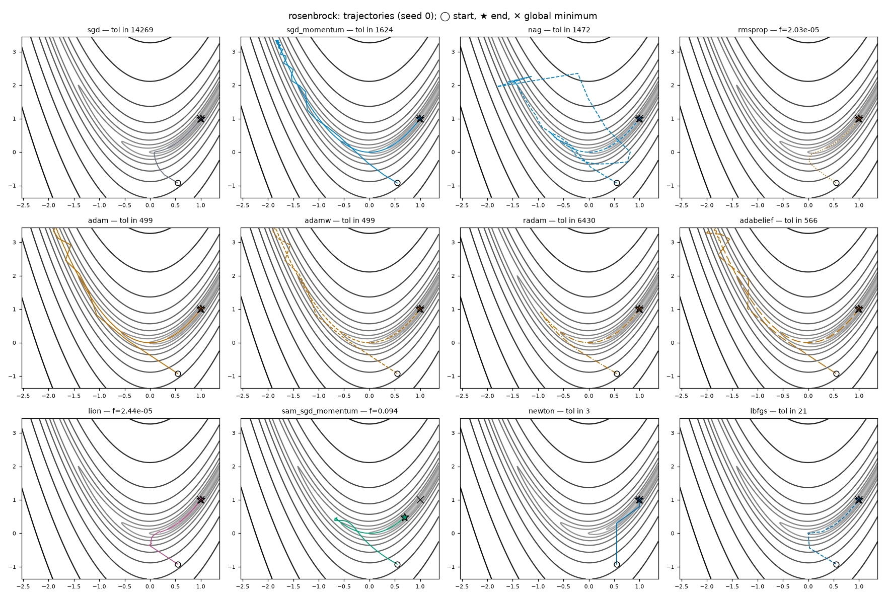
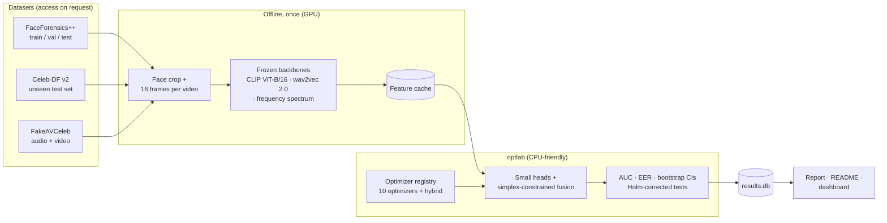
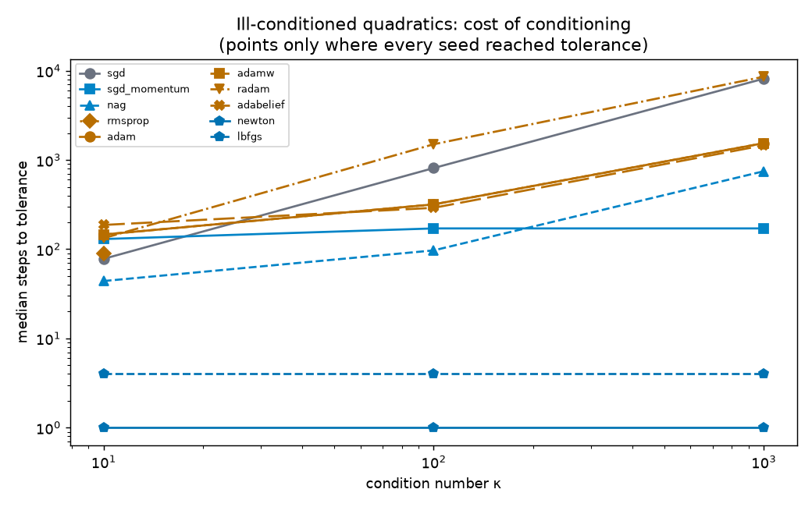
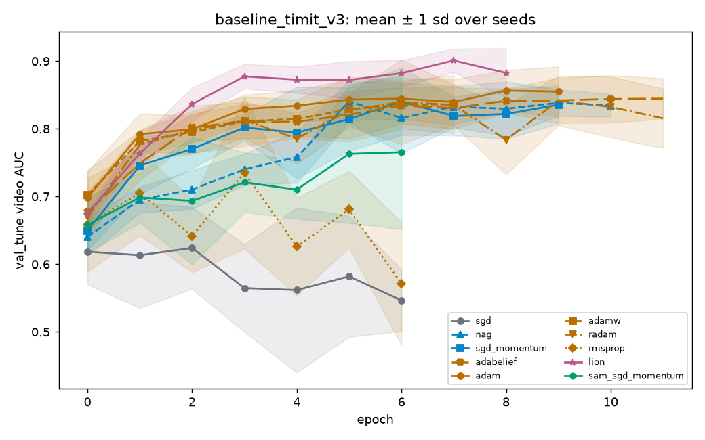
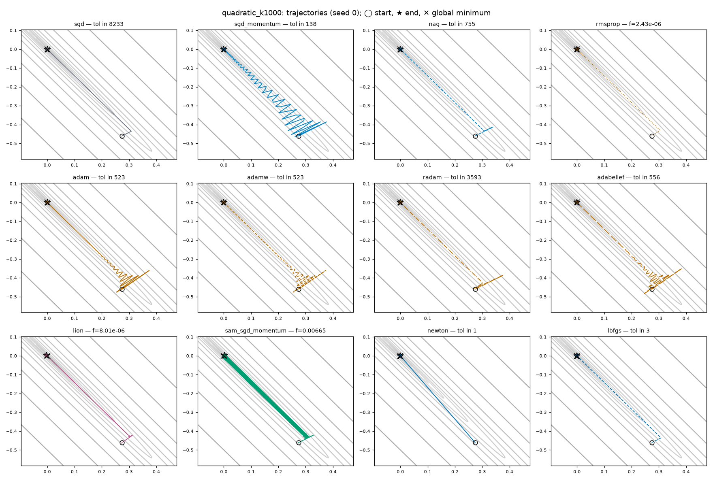
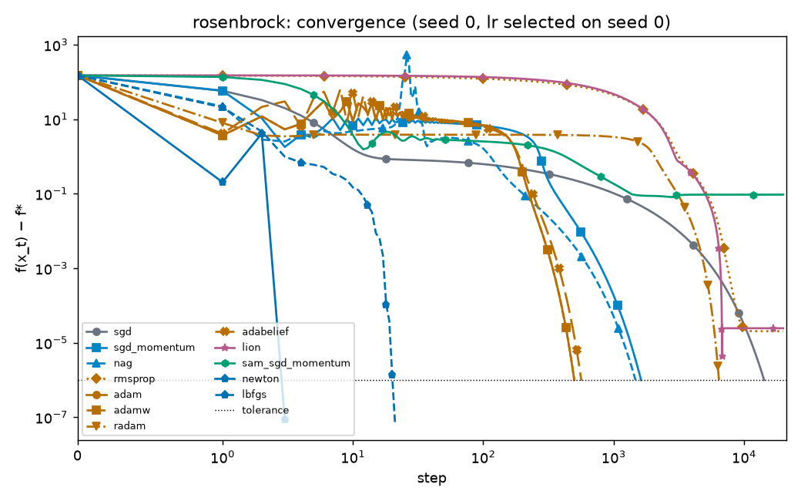
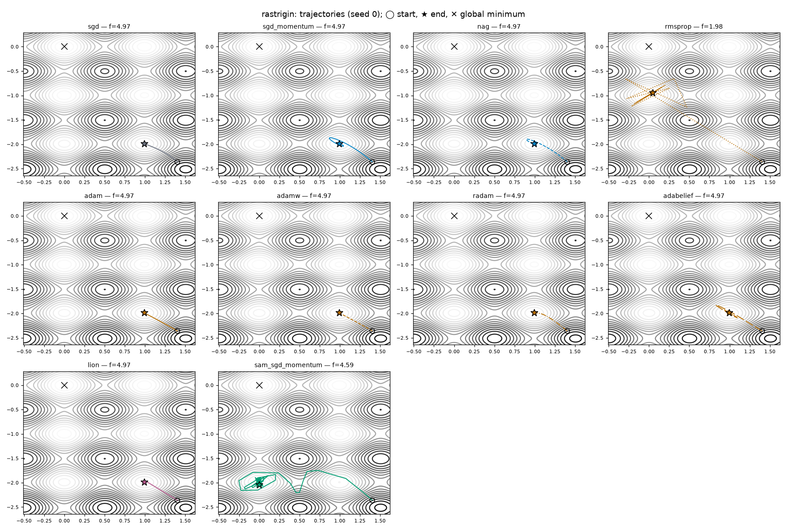
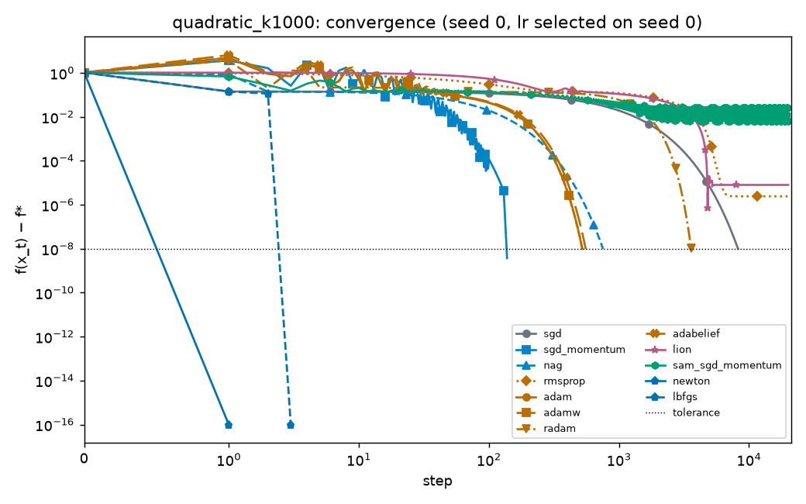

<div align="center">

# OptLab-DF

**Which optimizer trains the most robust multimodal deepfake detector, and can a hybrid do better?**

[](https://github.com/Aahan0605/cmai-project-/actions/workflows/ci.yml)


[](LICENSE)

*Innovative assignment · Computational Mathematics for AI & ML · B.Tech CSE-AIML, Nirma University*



<sub>Twelve optimizers on the Rosenbrock valley from the same start. ◯ start · ★ end · ✕ minimum at (1, 1).</sub>

</div>

---

## Contents

- [The question](#the-question)
- [Highlights](#highlights)
- [How it works](#how-it-works)
- [Phase 1 results: toy benchmarks](#phase-1-results-toy-benchmarks)
- [Phase 2 results: optimizer baselines](#phase-2-results-optimizer-baselines)
- [Gallery](#gallery)
- [Quickstart](#quickstart)
- [Project status and roadmap](#project-status-and-roadmap)
- [Repository layout](#repository-layout)
- [Limitations and ethics](#limitations-and-ethics)
- [References](#references)

## The question

> When training a multimodal deepfake detector, how do different optimizers compare in
> **convergence speed**, **stability** and, most importantly, **generalization to deepfakes
> from unseen datasets**? Can a **hybrid optimizer** designed from those findings do better?

Optimization is the subject of this project; deepfake detection is the testbed. Detectors
score very high on the dataset they were trained on and degrade on unseen manipulations, and
that generalization gap is where optimizer choice (and flat versus sharp minima) can plausibly
matter.

Most optimizer comparisons tune one optimizer harder than the rest, report a single seed and
declare a winner. OptLab-DF is built to avoid that:

- every optimizer gets the **same tuning budget**;
- each configuration runs with **5 seeds**;
- the **test set is written once** per run;
- results are reported as **mean ± std with confidence intervals**;
- a **null result counts as a finding**.

## Highlights

| | |
|---|---|
| **From-scratch optimizers** | SGD, Momentum, Nesterov, RMSProp and Adam written as `torch.optim.Optimizer` subclasses. Each matches PyTorch's own implementation within 1e-6 after 100 steps in float64. |
| **Sharpness-aware minimization** | SAM as a wrapper around any base optimizer. Parameters are restored bit-exactly after the ascent step (tested). |
| **Toy suite with known answers** | Ill-conditioned quadratics, Rosenbrock and Rastrigin, with Newton and L-BFGS as second-order references, on CPU in minutes. |
| **Constrained fusion** *(Phase 2)* | Modality weights on the probability simplex, solved through the KKT conditions or a QP. |
| **Honest by construction** | One SQLite results database; every table and plot in this README is generated from it. |
| **Reproducible** | YAML configs, resumable runs, git commit recorded per experiment, a library-versions column per training run (filled from Phase 2), CI on every push. |

## How it works



Heavy work (face cropping, feature extraction) happens once. Every optimizer comparison
then trains only small heads on cached features, so 10 optimizers × 5 seeds × an equal
tuning budget fits on a free GPU, or even a CPU.

### Optimizers under study

| Family | Optimizer | Implementation | Update |
|---|---|---|---|
| Plain | SGD | from scratch | θ ← θ − η g |
| Momentum | SGD + Momentum | from scratch | v ← μv + g; θ ← θ − η v |
| Momentum | Nesterov (NAG) | from scratch | v ← μv + g; θ ← θ − η (g + μv) |
| Adaptive | RMSProp | from scratch | s ← ρs + (1−ρ)g²; θ ← θ − η g / (√s + ε) |
| Adaptive | Adam | from scratch | bias-corrected first and second moments |
| Adaptive | AdamW | `torch.optim` | Adam + decoupled weight decay |
| Adaptive | RAdam | `torch.optim` | variance-rectified Adam |
| Adaptive | AdaBelief | `adabelief-pytorch` | Adam with the "belief" (g − m)² as second moment |
| Sign | Lion | `lion-pytorch` | sign of interpolated momentum |
| Sharpness-aware | SAM (+ SGD-M) | in-repo wrapper | gradient at θ + ρ g/‖g‖, then base step |
| Second-order | Newton, L-BFGS | in-repo / `torch.optim` | toy-benchmark references |
| Hybrid | designed in Phase 3 | — | built only after the baseline analysis |

## Phase 1 results: toy benchmarks

Before any deepfake training, every optimizer runs on functions whose minima are known:

- **Quadratic** ½xᵀAx with condition number κ ∈ {10, 100, 1000} and a rotated eigenbasis;
- **Rosenbrock**, a narrow curved valley;
- **Rastrigin**, with many local minima.

Each optimizer runs 5 seeds from random starts. Its learning rate is picked from a grid on
seed 0 and then reused for every seed.

<p align="center">
  
</p>

**Steps to tolerance**: median [min–max] over the seeds that converged (seeds converged /
seeds run); "—" means no seed converged. The table is copied verbatim from
[results/toy_summary.md](results/toy_summary.md), which `optlab toy-report` generates from the
database.

| optimizer | quadratic_k10 | quadratic_k100 | quadratic_k1000 | rosenbrock | rastrigin |
|---|---|---|---|---|---|
| sgd | 78 [56–82] (5/5) | 812 [582–850] (5/5) | 8153 [5841–8534] (5/5) | 14269 [13632–14676] (5/5) | — (0/5) |
| sgd_momentum | 130 [122–161] (5/5) | 171 [138–171] (5/5) | 171 [138–204] (5/5) | 1624 [1441–2266] (3/5) | — (0/5) |
| nag | 44 [34–44] (5/5) | 97 [24–98] (5/5) | 748 [538–782] (5/5) | 1452 [1432–1472] (2/5) | — (0/5) |
| rmsprop | 89 [58–136] (5/5) | 5984 (1/5) | — (0/5) | — (0/5) | — (0/5) |
| adam | 146 [101–169] (5/5) | 318 [133–500] (5/5) | 1544 [523–2091] (5/5) | 793 [499–1147] (4/5) | — (0/5) |
| adamw | 146 [101–169] (5/5) | 318 [133–500] (5/5) | 1544 [523–2091] (5/5) | 793 [499–1147] (4/5) | — (0/5) |
| radam | 133 [105–160] (5/5) | 1501 [386–1813] (5/5) | 8578 [3593–9493] (5/5) | 10558 [6430–10670] (3/5) | — (0/5) |
| adabelief | 187 [93–189] (5/5) | 291 [141–449] (5/5) | 1461 [556–1933] (5/5) | 805.5 [566–1143] (4/5) | — (0/5) |
| lion | 9009 [4969–9295] (3/5) | 7074 [5138–9010] (2/5) | — (0/5) | 3742 (1/5) | — (0/5) |
| sam_sgd_momentum | 291 (1/5) | — (0/5) | — (0/5) | — (0/5) | — (0/5) |
| newton | 1 [1–1] (5/5) | 1 [1–1] (5/5) | 1 [1–1] (5/5) | 4 [3–5] (5/5) |  |
| lbfgs | 4 [3–7] (5/5) | 4 [3–8] (5/5) | 4 [3–8] (5/5) | 21 [19–26] (5/5) |  |

**What the numbers show**
- **Conditioning hurts plain gradient descent the most.** Its median steps grow about 10× for
  every 10× in κ (78 → 812 → 8153), while momentum stays nearly flat (130 → 171 → 171).
- **Second-order methods ignore conditioning on quadratics.** Newton converges in 1 step at
  every κ, as theory says, and L-BFGS needs a median of 4.
- **Lion, RMSProp and SAM mostly miss tight tolerances at a fixed learning rate.** Lion takes
  fixed-size sign steps; RMSProp's step size does not shrink as the gradient does; and SAM's
  ascent step keeps length ρ even near the minimum, so SAM with a fixed ρ cannot settle
  exactly on it.
- **No optimizer escapes Rastrigin's local minima.** No first-order run reached the global
  minimum; the final value depends mainly on the start point.

The selected learning rates, final values and the hypothesis written before these runs are in
the [full summary](results/toy_summary.md).

## Phase 2 results: optimizer baselines

**Data.** FaceForensics++, Celeb-DF and FakeAVCeleb are available only on request, so Phase 2
runs on **OptLab-TIMIT**, an open real/fake dataset assembled from VidTIMIT (real) and
DeepfakeTIMIT (face swaps), both open access on Zenodo under CC BY-NC-ND 4.0. It has
32 people with 10 real and 10 fake clips each, split by person. The test uses higher-quality
fakes, and the "unseen" test uses lower-quality fakes of the same 4 held-out people. See the
[dataset card](docs/datasets/optlab_timit.md) for construction, licences, citations and the two
confounds found and removed along the way.

**Protocol.** 10 optimizers, 20 tuning trials each, then 5 seeds at the selected
hyperparameters: 50 runs, none diverged, 85 s of training in total on a laptop CPU.

<p align="center">
  
</p>

**Findings** (all from the results database; details in the
[baseline analysis](docs/baseline_analysis.md)):
- **No optimizer is distinguishable from another**: 0 of 45 pairs on either test after Holm
  correction. On the in-distribution test, nine of the ten lie within 0.025 AUC of each other
  (video AUC 0.748–0.773). This is a null result, limited by 5 seeds and 4 test people.
- **Plain SGD is the weakest**: lowest mean on both tests (0.707 and 0.803) and the noisiest,
  but not significantly worse.
- **Lion reaches the convergence target fastest and most reliably** (5 of 5 seeds, median 3
  epochs). Adaptive methods as a group are not consistently faster than SGD with momentum.
- **The lower-quality fakes turned out easier** (every optimizer scores higher on them), so
  this dataset cannot test generalization to *harder* unseen fakes.
- **Simplex fusion weights are not stream importance.** An audio stream that is uninformative
  by construction (AUC exactly 0.5 in every run) still gets an average weight of 0.35, because
  the weights also absorb the visual head's overconfidence. The constrained solver itself is
  exact (KKT residual < 1e-6 in all 50 runs).

Full tables, with bootstrap CIs and pairwise tests: [results/baseline_timit_v3/summary.md](results/baseline_timit_v3/summary.md).

## Gallery

<table>
  <tr>
    <td width="50%"><br><sub><b>κ = 1000 quadratic.</b> SGD with momentum zig-zags across the narrow valley; Newton jumps straight to the minimum.</sub></td>
    <td width="50%"><br><sub><b>Rosenbrock convergence.</b> f(xₜ) − f* against steps (log scale), seed 0.</sub></td>
  </tr>
  <tr>
    <td width="50%"><br><sub><b>Rastrigin.</b> Every first-order method stops in a local minimum, not the global one at the origin.</sub></td>
    <td width="50%"><br><sub><b>κ = 1000 convergence.</b> The dotted line is the 1e-8 tolerance.</sub></td>
  </tr>
</table>

## Quickstart

Requires [uv](https://docs.astral.sh/uv/). Python 3.11 is installed automatically.

```bash
git clone https://github.com/Aahan0605/cmai-project-.git
cd cmai-project-
make setup   # install dependencies
make test    # unit tests on CPU
make toy     # rerun the toy suite; regenerates results/toy_summary.md and every plot (~6 min, CPU)

# Phase 2 on open data (≈3.5 GB download, ≈35 min feature extraction on a laptop):
uv sync --extra extract
optlab fetch-timit && optlab prepare --dataset optlab_timit --root data/timit
optlab extract --dataset optlab_timit_hq --backbone clip_vit_b16 --root data/timit   # likewise lq, wav2vec2_base
optlab sweep --experiment baseline_timit_v3 && optlab stats --experiment baseline_timit_v3
```

### Command-line interface

```bash
optlab init-db                                   # create results/results.db, load catalogues
optlab toy [--force]                             # toy benchmarks (resumable)
optlab toy-report                                # tables, plots and summary from the DB
optlab prepare --dataset ff++ --root DATA/FF++   # identity-disjoint split manifests
optlab extract --dataset ff++ --backbone clip_vit_b16 --root DATA/FF++ --device cuda
optlab sweep --experiment baseline_v1           # tune -> train -> fuse -> evaluate, resumable
optlab stats --experiment baseline_v1           # leaderboard, CIs, pairwise tests, gap, plots
optlab evaluate --run-id 12 --final             # test splits are written once; --force is flagged
optlab merge-db a.db b.db --out merged.db        # combine databases from separate GPU sessions
```

Feature extraction needs the optional extras (`uv sync --extra extract`) and a local copy of
each dataset. FaceForensics++, Celeb-DF v2 and FakeAVCeleb are distributed by their authors on
request; this repository only ever stores split manifests, never videos, frames or faces.

## Project status and roadmap


| Phase | Content | State |
|---|---|---|
| 0 Setup | Configs, results database (schema v2), data pipeline | ✅ Done |
| 1 Toy benchmarks | Optimizers checked against known minima | ✅ Done |
| 2 Baselines | Equal-budget tuning, 5 seeds, in-distribution + unseen-fake tests | ✅ Done on OptLab-TIMIT ([analysis](docs/baseline_analysis.md)); FF++ / Celeb-DF still pending access |
| 3 Hybrid design | Update rule motivated by the Phase 2 findings; frozen before testing | Planned |
| 4 Hybrid evaluation | Same budget and seeds as the baselines, plus ablations | Planned |
| 5 Presentation | Read-only API and results dashboard | Planned |

The hybrid optimizer is designed only after the baselines are analysed, and its design is
committed before it ever sees a test split, so it cannot be tuned against the benchmark it is
judged on. A hybrid that turns out *not* to beat the baselines will be reported with the same
prominence.

## Repository layout

```
configs/            YAML: optimizer search spaces, models, datasets, splits, experiments
src/optlab/
  optim/            from-scratch optimizers, SAM wrapper, registry
  toy/              benchmark functions, runner, report and plots
  data/             manifests, face crop, frame sampling, extractors, feature cache, dataset
  db/               SQLite connection, migrations, repository, merge
  models/           per-modality heads with late fusion
  train/            trainer (clipping, early stopping, divergence), in-memory splits
  tune/             equal-budget random / grid / PSO / GA search
  fusion/           simplex fusion: cvxpy QP, KKT closed form, projected gradient
  eval/             metrics, bootstrap CIs, Holm-corrected tests, stats report
  pipeline.py       tune -> train -> fuse -> evaluate -> sweep, recorded in the DB
  cli.py            the `optlab` command
backend/schema.sql  results database schema (migrations in src/optlab/db/migrations/)
results/            generated toy summary, tables and plots
tests/              pytest suite (CPU only, no datasets needed)
docs/               PRD, TRD, architecture and dashboard design
```

The design documents explain the reasoning in depth. [docs/PRD.md](docs/PRD.md) covers the
goals, protocol and how each part maps to the syllabus; [docs/TRD.md](docs/TRD.md) is the
technical specification; [docs/ARCHITECTURE.md](docs/ARCHITECTURE.md) has the diagrams.

## Limitations and ethics

- **Frozen backbones.** Findings may not transfer to full fine-tuning; Phase 4 includes a
  limited "unfreeze the last layers" check.
- **Audio.** FaceForensics++ and Celeb-DF have no audio. Without FakeAVCeleb the detector is
  multi-stream (visual + frequency) rather than truly multimodal.
- **Toy tuning.** Learning rates are chosen on seed 0 and reused, so seed 0 is not held out.
  Some momentum runs diverge on Rosenbrock at other seeds because of this.
- **Detection only.** This repository contains no generation code. Deepfake detectors can
  fail on unseen generators and must never be the only evidence about a real person's media.

## References

- Kingma & Ba (2015). *Adam: A Method for Stochastic Optimization.*
- Loshchilov & Hutter (2019). *Decoupled Weight Decay Regularization.*
- Liu et al. (2020). *On the Variance of the Adaptive Learning Rate and Beyond.* (RAdam)
- Zhuang et al. (2020). *AdaBelief Optimizer.*
- Chen et al. (2023). *Symbolic Discovery of Optimization Algorithms.* (Lion)
- Foret et al. (2021). *Sharpness-Aware Minimization for Efficiently Improving Generalization.*
- Rössler et al. (2019). *FaceForensics++.*
- Li et al. (2020). *Celeb-DF.*
- Khalid et al. (2021). *FakeAVCeleb.*
- Korshunov & Marcel (2018). *DeepFakes: a New Threat to Face Recognition? Assessment and Detection.* (DeepfakeTIMIT)
- Sanderson & Lovell (2009). *Multi-Region Probabilistic Histograms for Robust and Scalable Identity Inference.* (VidTIMIT)

## License

[MIT](LICENSE) © 2026 Aahan Ajay Gajera
