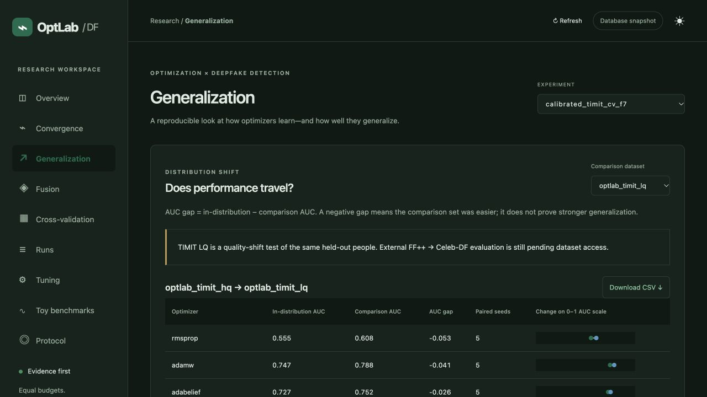

# OptLab-DF

**A reproducible optimizer benchmark for multimodal deepfake detection, with a results dashboard.**

[](https://github.com/Aahan0605/cmai-project-/actions/workflows/ci.yml)


[](LICENSE)

OptLab-DF asks: **how does optimizer choice affect convergence, stability, and generalization
when every optimizer receives the same tuning budget?** It trains small detection heads on
frozen visual, audio, and frequency features, evaluates them on held-out identities, and
records the experiment in SQLite. A React dashboard makes the runs and uncertainty inspectable.

The project is a Computational Mathematics for AI & ML assignment at Nirma University.
Optimization is the subject; deepfake detection is the experimental testbed. The interface
is a research results explorer. Video-upload prediction is outside the implemented workflow.

## Contents

- [What is implemented](#what-is-implemented)
- [Quick start](#quick-start)
- [System architecture](#system-architecture)
- [How an experiment works](#how-an-experiment-works)
- [Data and reproducibility](#data-and-reproducibility)
- [Results](#results)
- [Dashboard and API](#dashboard-and-api)
- [Configuration and commands](#configuration-and-commands)
- [Project status](#project-status)
- [Repository layout](#repository-layout)
- [Development and testing](#development-and-testing)
- [Troubleshooting](#troubleshooting)
- [Limitations and responsible use](#limitations-and-responsible-use)

## What is implemented

| Component | What it does |
|---|---|
| Optimizer library | From-scratch SGD, Momentum, NAG, RMSProp and Adam; AdamW, RAdam, AdaBelief and Lion integrations; a SAM wrapper |
| Toy benchmarks | Ill-conditioned quadratics, Rosenbrock and Rastrigin; Newton and L-BFGS references |
| Data pipeline | Identity-disjoint manifests, sampled face crops, frozen CLIP/wav2vec2 features, frequency spectrum, validated feature caches |
| Experiment runner | Equal-budget random/grid/PSO/GA tuning, seeded training, class balancing, clipping, early stopping, best checkpoints, resumable sweeps |
| Fusion | Optional per-stream calibration, simplex or scaled-simplex fusion, persisted transforms and KKT diagnostics |
| Evaluation | Frame/video AUC, EER, accuracy, F1, AP, bootstrap intervals and Holm-corrected comparisons |
| Grouped CV | Eight TIMIT folds, all 32 people tested once, seed-averaged comparisons paired by fold |
| Results backend | Migrated SQLite schema, atomic writes, read-only FastAPI, conflict-detecting database merge, static snapshot export |
| Frontend | Overview, convergence, generalization, fusion, CV, searchable runs, tuning, toy curves/trajectories, protocol, CSV exports and shareable links |

## Quick start

### 1. Explore the existing results

The checked-in snapshot works without Python, a GPU, datasets, or a running API.
Install Node.js **22.12+** (Node 24 is used in CI) and **pnpm 10.28.1**, then:

```bash
git clone https://github.com/Aahan0605/cmai-project-.git
cd cmai-project-
pnpm --dir frontend install --frozen-lockfile
pnpm --dir frontend dev
```

Open **http://localhost:5173**. Select an experiment and a view in the sidebar. Choose
**Cross-validation** on a calibrated fold to inspect all eight folds. **Toy benchmarks**
shows the mathematical benchmarks; **Runs** and **Tuning** expose individual records.

For a static production build:

```bash
pnpm --dir frontend build
pnpm --dir frontend preview
```

Deploy the contents of `frontend/dist`. Relative asset paths support a repository subpath,
and navigation uses query parameters. The production build does not include Vite's API proxy.

### 2. Set up the Python backend

Install [uv](https://docs.astral.sh/uv/getting-started/installation/). Run all Python commands
from the repository root; configs and local artifact paths are resolved from that directory.

```bash
uv sync --frozen --extra api
uv run optlab init-db
uv run pytest
uv run optlab serve
```

The API runs at **http://127.0.0.1:8000**; interactive docs are at
**http://127.0.0.1:8000/api/docs**. In a second terminal:

```bash
VITE_DATA_MODE=api pnpm --dir frontend dev
```

`results/results.db` is a local generated file and is excluded from Git. A fresh `init-db`
creates empty result tables and seeds the catalogues; it does **not** reconstruct historical
runs from the committed JSON snapshot. The snapshot and reports remain available for browsing.
To populate a new database without datasets, run:

```bash
uv run optlab toy
uv run optlab toy-report
uv run optlab export-snapshot
```

That final command replaces the dashboard snapshot with results from the selected database.
Use `--out /tmp/optlab-demo-data` if you want a separate export. Toy optimization runs on CPU;
its runtime depends on the machine and configuration. `make toy` additionally forces a rerun
of existing toy results.

For both runtimes together, `make setup` installs dependencies and `make check` runs checks.



## System architecture

```mermaid
flowchart LR
    DATA["Local licensed videos and audio"]
    CFG["YAML configs + identity manifests"]
    PREP["Sample frames → face crops → frozen feature extraction"]
    CACHE[("Feature shards and indices")]
    TRAIN["Equal-budget tuning + seeded head training"]
    CAL["Stream calibration on val_tune"]
    FUSE["Constrained fusion on val_fusion"]
    EVAL["Held-out frame/video evaluation"]
    DB[("SQLite results.db")]
    QUERY["Shared Python query layer"]
    API["Read-only FastAPI"]
    SNAP["Static JSON snapshot"]
    WEB["React / TypeScript dashboard"]
    REPORT["CSV + Markdown + PNG reports"]
    DATA --> PREP --> CACHE --> TRAIN --> CAL --> FUSE --> EVAL --> DB
    CFG --> PREP
    CFG --> TRAIN
    TRAIN --> DB
    FUSE --> DB
    DB --> QUERY
    QUERY --> API --> WEB
    QUERY --> SNAP --> WEB
    DB --> REPORT
```



The Python pipeline produces results offline. The frontend consumes the same JSON contract
from either the API or a static snapshot. API requests open SQLite read-only, and the frontend
has no write or training endpoint.

See [the detailed architecture](docs/ARCHITECTURE.md) for the module map, training sequence,
ER diagram, fusion formulation, API contract, failure recovery, and deployment boundaries.

## How an experiment works

1. **Prepare identities and splits.** Every face-swap target and donor belongs to a connected
   identity component. Whole components stay in one training, tuning, fusion, or test role.
   Manifests are checked for duplicate videos and identity leakage.
2. **Extract features once.** CLIP ViT-B/16 encodes face crops, wav2vec 2.0 encodes available
   audio, and a radial frequency spectrum supplies a third stream. Features are stored as
   float16 NPY shards with indices and preprocessing metadata. Caches publish after completion.
3. **Tune fairly.** Every optimizer gets the same number of trials and shortened training
   budget. Diverged trials count. Validation-tuning video AUC selects hyperparameters and
   the checkpoint; final training repeats the chosen settings over five seeds.
4. **Calibrate and fuse.** If enabled, fit positive stream scales on `val_tune`, then freeze
   them. Fit nonnegative mixing weights on `val_fusion`. Scaled-simplex fusion also learns
   a shared logit scale. The solver verifies a KKT residual below `1e-6`.
5. **Evaluate once.** Thresholds come from validation. The selected checkpoint, calibration,
   and fusion parameters are reused for the configured in-distribution and cross-dataset tests.
   Test writes require an explicit, flagged override to replace existing results.
6. **Report uncertainty.** Show seed counts, means, standard deviations, bootstrap intervals,
   and adjusted statistical tests. CV first averages seeds within a fold and compares optimizers
   paired by fold. No detected difference does not establish equivalence.

The heads minimize the sum of binary cross-entropy across streams. Frozen backbones make
optimizer comparisons cheaper, while also limiting conclusions to head training. Calibration
reduces scale confounding; mixing weights still reflect redundancy and validation sampling,
so they do not measure causal stream importance. `val_tune` is reused for several selection
steps, so its calibration loss is a fit diagnostic rather than independent validation evidence.

## Data and reproducibility

### OptLab-TIMIT: the completed local study

OptLab-TIMIT combines VidTIMIT real recordings with DeepfakeTIMIT swaps. It retains the
**32 face-swapped people in 16 pairs**, with 10 real and 10 fake clips per person per quality.
HQ and LQ manifests each contain 640 videos. Reals and fakes receive matching encoding
passes, and fake audio is aligned with its original real audio to reduce label shortcuts.
See the [dataset card](docs/datasets/optlab_timit.md) for construction, caveats, sources and terms.

To reproduce from source data, install the optional extraction dependencies. Pretrained models
are downloaded on first use. Video standardization requires an OpenCV build with H.264 encoding;
FFmpeg on `PATH` is needed when decoding audio from videos without sibling WAV files.

```bash
uv sync --frozen --extra api --extra extract
uv run optlab init-db
uv run optlab fetch-timit
uv run optlab prepare --dataset optlab_timit --root data/timit

# Visual extraction also writes the frequency stream.
uv run optlab extract --dataset optlab_timit_hq --backbone clip_vit_b16 --root data/timit
uv run optlab extract --dataset optlab_timit_lq --backbone clip_vit_b16 --root data/timit
uv run optlab extract --dataset optlab_timit_hq --backbone wav2vec2_base --root data/timit
uv run optlab extract --dataset optlab_timit_lq --backbone wav2vec2_base --root data/timit

uv run optlab cv --experiment calibrated_timit_cv
uv run optlab export-snapshot
```

`--device cuda` or `--device mps` selects an extraction backbone device; `--detector-device`
selects the face detector device. Experiment YAML `device` controls head training. CPU is the
routine test target; accelerators need compatible PyTorch hardware and dependencies.

Keep raw media, crops, feature arrays and checkpoints local. Dataset terms are separate from
the repository's MIT code licence. Downloads, extraction, and the full sweep need additional
storage and time. Existing caches are protected from accidental overwrite; choose a new
feature root after changing preprocessing.

### External evaluation: access still required

[calibrated_external.yaml](configs/experiments/calibrated_external.yaml) trains visual and
frequency heads on **FaceForensics++** and tests them on **Celeb-DF v2**. This experiment has
no results yet. Obtain the datasets from their authors and respect their access conditions.

```bash
uv run optlab prepare --dataset ff++ --root /path/to/FaceForensics++
uv run optlab prepare --dataset celeb-df --root /path/to/Celeb-DF-v2
uv run optlab extract --dataset faceforensics_pp --backbone clip_vit_b16 --root /path/to/FaceForensics++
uv run optlab extract --dataset celeb_df_v2 --backbone clip_vit_b16 --root /path/to/Celeb-DF-v2
uv run optlab sweep --experiment calibrated_external
uv run optlab stats --experiment calibrated_external
```

The parsers have layout tests using synthetic fixtures; real-download verification awaits access.
The external config uses visual and frequency streams because audio is not assumed available.
FakeAVCeleb has a dataset catalogue entry but no verified preparation parser yet.

## Results

### Calibrated grouped cross-validation

The completed study contains **400 runs: 8 folds × 10 optimizers × 5 seeds**. Each fold holds
out two swap pairs (four people), uses the next fold for separate tuning/fusion roles, and
trains on the remaining folds. All 32 people are tested exactly once.

| optimizer | folds | AUC mean ± sd over folds | 95% CI |
|---|---|---|---|
| lion | 8 | 0.6789 ± 0.1019 | [0.6099, 0.7412] |
| adabelief | 8 | 0.6777 ± 0.1062 | [0.6055, 0.7440] |
| adamw | 8 | 0.6738 ± 0.0990 | [0.6067, 0.7340] |
| adam | 8 | 0.6637 ± 0.1113 | [0.5888, 0.7311] |
| sgd_momentum | 8 | 0.6626 ± 0.0913 | [0.6046, 0.7250] |
| radam | 8 | 0.6621 ± 0.1029 | [0.5952, 0.7269] |
| nag | 8 | 0.6587 ± 0.0877 | [0.6009, 0.7136] |
| rmsprop | 8 | 0.6346 ± 0.0661 | [0.5915, 0.6769] |
| sgd | 8 | 0.6123 ± 0.0632 | [0.5726, 0.6530] |
| sam_sgd_momentum | 8 | 0.5724 ± 0.0760 | [0.5264, 0.6237] |

Video AUC on HQ, averaged over seeds within each fold and then across folds. The table is
copied from the [generated CV report](results/calibrated_timit_cv/summary.md).
**No optimizer pair passes both the interval and Holm-adjusted significance criteria** on
HQ or LQ (0 of 45 pairs for each dataset). Ordering these means does not establish a winner.
The lower-quality shift uses the same held-out people and is easier in these measurements;
it does not establish performance on unseen generators. Shared training data across folds
limits independence.


### Earlier studies

- [Toy benchmark summary](results/toy_summary.md): known minima, steps to tolerance,
  selected learning rates, and limitations. Newton/L-BFGS are toy references.
- [Single-split baseline results](results/baseline_timit_v3/summary.md): five seeds on four
  test people, before stream calibration and rotating held-out identities.
- [Baseline analysis](docs/baseline_analysis.md): detected audio/identity shortcuts,
  superseded experiment history, and the motivation for calibration and broader testing.


## Dashboard and API

| View | Purpose |
|---|---|
| Overview | Run coverage, video test AUC, intervals, CSV and pairwise comparisons |
| Convergence | Training/validation curves; early stopping can change replicate counts per epoch |
| Generalization | Matched-seed in-distribution vs comparison AUC, separately by dataset |
| Fusion | Stream weights, calibration NLL/scales and solver residuals |
| Cross-validation | Seed-averaged fold statistics and paired comparisons |
| Runs | Search/filter, selected run details, hyperparameters, evaluations, raw metadata and CSV |
| Tuning | Every recorded trial, selected hyperparameters, divergence and validation scores |
| Toy benchmarks | Objective curves, available 2D trajectories, per-seed outcomes and CSV |
| Protocol | Split roles, calibration and outstanding external evaluation |

Views and run selection use URL query parameters, for example
`?view=Runs&experiment=7&run=202`. The IDs depend on your database. Browser Back/Forward works;
theme choice is saved locally. API queries refresh every 15 seconds. Snapshots update when
exported; use Refresh after exporting.

Useful endpoints are `GET /api/meta`, `/api/experiments`, `/api/optimizers`,
`/api/experiments/{id}/leaderboard`, `/api/experiments/{id}/generalisation`,
`/api/experiments/{id}/tuning`, `/api/runs/{id}`, `/api/cv/{base}`, and `/api/toy`.
The backend uses British spelling `generalisation`; the UI label is Generalization.
Full schemas are at `/api/docs`.

For a separately hosted live API, set `VITE_API_BASE_URL=https://your-api.example` at frontend
build time and pass the actual frontend origin to `optlab serve --cors-origin`. These are
public configuration values, not secrets. The API has no authentication and binds to localhost
by default; see [SECURITY.md](SECURITY.md) before exposing it on a network.

## Configuration and commands

| Path | Controls |
|---|---|
| `configs/experiments/*.yaml` | Datasets, optimizer set, seeds, tuning/training budgets, fusion, paths and device |
| `configs/optim/*.yaml` | Fixed optimizer settings and search spaces |
| `configs/model/*.yaml` | Frozen backbone IDs, active streams, head size and dropout |
| `configs/data/extraction.yaml` | Sampling, cropping, backbones, spectrum and cache shards |
| `configs/data/splits.yaml` | Split fractions, seed and validation-fusion share |
| `manifests/*.csv` | Video IDs/paths, labels, target/donor identities and split roles |

Configs reject unknown fields, non-finite numbers and invalid budgets. The cached-feature
trainer supports frozen backbones with weighted-sum fusion. Concat-MLP, SVM fusion and
backbone fine-tuning are future model variants and fail explicitly if requested.

Use a **new experiment name and config** when changing scientific settings. Run keys identify
an experiment/optimizer/model/seed; they do not fingerprint all mutable configs and inputs.
Resuming is safe only when the original experiment and caches are unchanged.

```bash
uv run optlab --help
uv run optlab tune --experiment baseline_timit_v3 --optimizer adam
uv run optlab train --experiment baseline_timit_v3 --optimizer adam --seed 0
uv run optlab sweep --experiment baseline_timit_v3
uv run optlab cv --experiment calibrated_timit_cv --prepare-only
uv run optlab cv-stats --experiment calibrated_timit_cv
uv run optlab fuse --run-id 12
uv run optlab evaluate --run-id 12 --final
uv run optlab merge-db session-a.db session-b.db --out merged.db
uv run optlab export-snapshot --db merged.db --out /tmp/merged-snapshot
```

`--config /path/to/experiment.yaml` can replace `--experiment`. Run commands from the repo
root so stored config and artifact paths resolve. Merging databases remaps IDs and detects
conflicting results; it does not copy artifact files. Move checkpoints/trajectories separately.
`evaluate --force` overwrites and flags test metrics; fusion cannot be refitted after testing.

## Project status

| Area | Status |
|---|---|
| Optimizer maths and toy suite | Implemented and tested |
| TIMIT data preparation and features | Implemented; dataset card documents construction caveats |
| Single-split baselines | Completed; superseded runs preserved |
| Calibrated grouped CV | Completed: 400 runs, eight folds, all 32 people |
| Results API and static export | Implemented; schema v4; shared contract tests |
| Frontend and CI | Implemented; Python/frontend checks, build and fresh-DB smoke test |
| FF++ → Celeb-DF | Configured; blocked on author-granted dataset access and real-layout verification |
| FakeAVCeleb | Catalogue only; parser and dataset-backed study pending |
| Hybrid optimizer and ablations | Research work pending: write/freeze a design, validate it, then evaluate on an untouched test |
| Concat/SVM heads and backbone fine-tuning | Future model variants; outside the current cached-head pipeline |

The existing baseline study found weak evidence of optimizer superiority. A hybrid designed
from these observations must be framed as exploratory, and new confirmatory claims need a
fresh evaluation. The planning documents describe intended research scope, not completed work.

## Repository layout

```text
.github/workflows/       Python + frontend CI
backend/schema.sql       Base SQLite schema
configs/                 Experiments, models, optimizers, extraction and splits
docs/                    Architecture, specifications, analysis and dataset card
manifests/               Identity-disjoint CSV splits, including generated CV folds
src/optlab/
  data/                  Preparation, crops, extraction, feature cache and datasets
  optim/                 Optimizer implementations and registry
  models/ train/ tune/   Heads, training loop and equal-budget search
  fusion/                Calibration, constrained solvers and KKT checks
  eval/                  Metrics, statistics and report generation
  db/                    Connections, migrations, repository and merge
  export/                Shared queries and static snapshot generation
  toy/                   Known-minimum objectives, runner and plots
  api.py cli.py          Read-only HTTP API and command-line entry point
frontend/
  src/                   React views, shared data layer and frontend tests
  public/data/           Committed JSON snapshot of recorded results
results/                 Committed reports/plots; results.db stays local
tests/                   Python unit, integration and contract tests
```

## Development and testing

```bash
make setup
make check                  # lint/format checks, Python + frontend tests, production build
make dev                    # snapshot frontend
make api                    # read-only API
make snapshot               # export the chosen local results DB
make cv                     # calibrated TIMIT grouped sweep; needs feature caches
```

Individual checks:

```bash
uv run ruff check src tests
uv run ruff format --check src tests
uv run pytest
pnpm --dir frontend format:check
pnpm --dir frontend test
pnpm --dir frontend build
```

Tests use synthetic features and dataset-layout fixtures, including API/snapshot parity,
write-once evaluation, solver regressions, optimizer reference checks, cache corruption,
identity leakage, merge conflicts, CLI validation, and frontend navigation/error cases.
Optional OpenCV-dependent tests skip if OpenCV is absent. External data and GPU execution
require their own validation. See [CONTRIBUTING.md](CONTRIBUTING.md) for contribution and
result-integrity rules. The [development review](docs/DEVELOPMENT_REVIEW.md) records the
fixed failures, verification scope, and remaining work.

## Troubleshooting

| Symptom | Action |
|---|---|
| `optlab: command not found` | Use `uv run optlab …` from the repository root |
| Schema mismatch or missing tables | Run `uv run optlab init-db --db YOUR_DB` with this checkout; back up valuable databases before migrating |
| Live dashboard has no historical results | A new DB is empty; switch to the checked-in snapshot or reproduce/import the intended runs |
| Snapshot returns HTML / missing JSON | Export from the intended DB; ensure `frontend/dist/data` is deployed; select the correct data mode |
| `/api` fails in production | Vite's proxy is development-only; configure a reverse proxy or `VITE_API_BASE_URL` and CORS |
| Missing feature/audio rows | Extract every active stream for the target dataset; verify matching video IDs and frame indices |
| Existing cache is refused | Use a new feature directory after changing extraction; do not mix partial or differently processed shards |
| OpenCV cannot write H.264 | Use an OpenCV/FFmpeg environment with an H.264 encoder before building TIMIT clips |
| Node engine or pnpm lockfile error | Use the documented Node/pnpm versions and `--frozen-lockfile` |
| Missing toy trajectory | Numerical records can be viewed; original NPZ artifacts are local and may not be available on another machine |
| CV counts differ across optimizers | The sweep may be partial or contain failed/diverged runs; inspect coverage before drawing conclusions |

## Limitations and responsible use

- Frozen-backbone head training does not establish results for end-to-end model fine-tuning.
- TIMIT contains older face swaps, frontal recordings, and a small identity population.
  The HQ-to-LQ shift does not measure unseen-generator generalization.
- Five seeds describe initialization variability. Eight overlapping training folds provide
  broader identity coverage, but dependent folds limit statistical interpretation.
- Calibration and checkpoint selection share `val_tune`; those fit metrics are optimistic.
- Encoding/audio normalization reduces known shortcuts without proving all shortcuts are gone.
- This research detector is not evidence about a person's honesty or the authenticity of
  arbitrary real-world media. Do not use its scores for consequential decisions about people.
- Dataset permissions apply separately to code. Do not redistribute raw recordings, derived
  faces/audio, caches or checkpoints without verifying the relevant terms.

## References

- Kingma & Ba (2015). *Adam: A Method for Stochastic Optimization.*
- Loshchilov & Hutter (2019). *Decoupled Weight Decay Regularization.*
- Liu et al. (2020). *On the Variance of the Adaptive Learning Rate and Beyond.* (RAdam)
- Zhuang et al. (2020). *AdaBelief Optimizer.*
- Chen et al. (2023). *Symbolic Discovery of Optimization Algorithms.* (Lion)
- Foret et al. (2021). *Sharpness-Aware Minimization for Efficiently Improving Generalization.*
- Rössler et al. (2019). *FaceForensics++.*
- Li et al. (2020). *Celeb-DF.*
- Khalid et al. (2021). *FakeAVCeleb.*
- Korshunov & Marcel (2018). *DeepFakes: a New Threat to Face Recognition? Assessment and Detection.* (DeepfakeTIMIT)
- Sanderson & Lovell (2009). *Multi-Region Probabilistic Histograms for Robust and Scalable Identity Inference.* (VidTIMIT)

## License

Code: [MIT](LICENSE) © 2026 Aahan Ajay Gajera. Dataset and pretrained-model terms remain
those of their respective authors.
