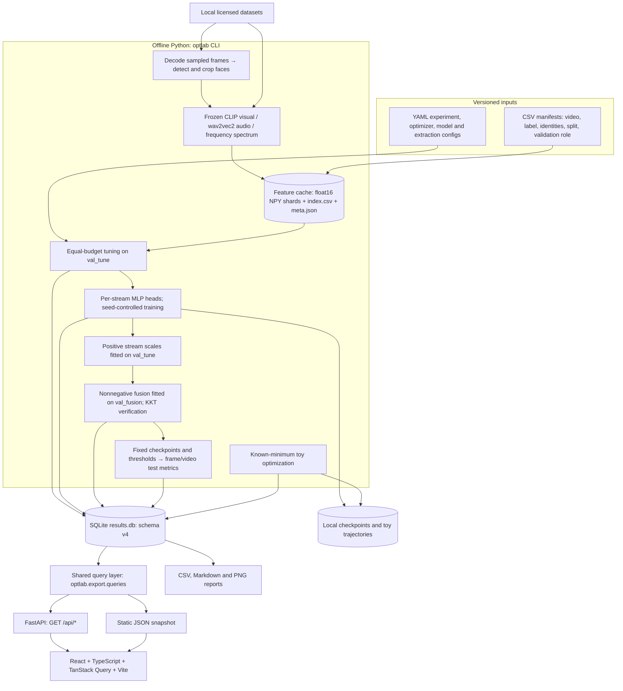
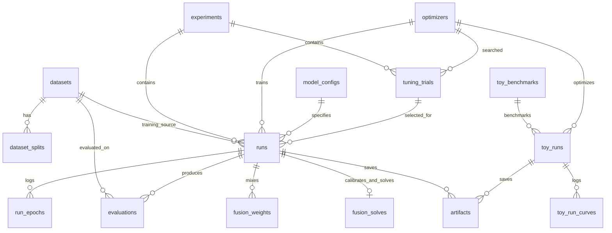

# System architecture

This document describes the implemented system. The PRD, TRD, and UI/UX specification
include future research ideas; consult the README status table before treating them as
available features.

## Runtime boundaries

OptLab-DF has two independent runtimes: an offline Python experiment pipeline and a
read-only React results dashboard. The frontend does not upload videos or launch training.
There is no task queue, model-serving endpoint, user account system, or cloud service.



Manifests are prepared before extraction; the same caches can serve different folds because
fold membership is selected through manifests. Cached feature vectors are treated as frozen
inputs. The current trainer rejects non-frozen backbone and unsupported fusion-model configs.

## Modules and responsibilities

| Module | Responsibility |
|---|---|
| `cli.py`, `config.py` | CLI commands; strict YAML validation; catalogue initialization |
| `data/manifest.py`, `cv.py` | Identity components; split/validation-role checks; rotating grouped folds |
| `data/timit.py` | Download, standardize, and pair TIMIT video/audio sources |
| `data/preprocess.py`, `faces.py`, `extractors.py`, `extract.py` | Sample frames, crop faces, extract visual/audio/frequency features |
| `data/cache.py`, `dataset.py`, `train/data.py` | Stage/publish caches; validate rows and dimensions; load selected splits |
| `optim/` | Five from-scratch first-order optimizers, external optimizer builders, SAM |
| `tune/search.py` | Random, grid, PSO and GA with an exact trial budget |
| `train/trainer.py`, `models/heads.py` | Small independent heads; class-balanced sampling; clipping and early stopping |
| `fusion/` | Calibration; convex simplex or nonnegative scaled-simplex fusion; KKT diagnostics |
| `pipeline.py` | Resumable tune → train → fuse → evaluate orchestration |
| `db/` | Connections, migrations, atomic writes, catalogues, conflict-detecting merges |
| `eval/` | Metrics, bootstrap statistics, paired fold tests, reports |
| `api.py`, `export/` | Read-only endpoints and consistent static snapshots with one JSON contract |
| `frontend/src/` | Overview, convergence, generalization, fusion, CV, runs, tuning, toy benchmarks, protocol |

## Training and evaluation sequence

```mermaid
sequenceDiagram
    participant CLI as optlab CLI
    participant Data as Cached splits
    participant Train as Trainer and tuner
    participant Fusion as Calibration and fusion
    participant DB as SQLite
    CLI->>Data: Load train / val_tune / val_fusion
    Note over Data: Connected identities cannot cross split or validation roles
    loop Exact tuning budget per optimizer
        Train->>Train: Train heads; choose checkpoint on val_tune video AUC
        Train->>DB: Record hyperparameters, validation metrics, divergence
    end
    loop Each seed at selected hyperparameters
        Train->>DB: Running status; epoch records
        Train->>Train: Retain best validation checkpoint
        Train->>DB: Completed/diverged/failed status and provenance
        CLI->>Fusion: Load completed checkpoint
        Fusion->>Fusion: Fit stream scales on val_tune, if enabled
        Fusion->>Fusion: Fit weights on val_fusion; verify KKT residual
        Fusion->>DB: Store scales, weights, contribution and solver diagnostics
        CLI->>Data: Load configured test datasets
        CLI->>DB: Write frame/video test metrics once, atomically
    end
```

Training uses the configured PyTorch device. Checkpoints load onto CPU for batched fusion
and evaluation. CPU is tested routinely; accelerator execution requires compatible hardware
and dependencies. Extraction has separate backbone and face-detector device arguments.

### Fusion mathematics

For stream logits `z_m`, optional calibration fits positive scales `a_m` by minimizing binary
log loss on `val_tune`. Positive scales preserve the stream's ranking. With calibration
frozen, the fusion split fits either:

- **Simplex:** `w_m >= 0`, `sum(w) = 1`, minimize fused binary log loss.
- **Simplex with temperature:** solve for `u_m >= 0` with a ridge penalty, then recover
  `s = sum(u)` and `w = u/s`. The fused score is `s * sum(w_m * a_m * z_m)`.

The second problem is convex in `u`. `s` is a multiplicative logit scale (inverse temperature
in common probability-calibration terminology). A legacy solver label is `qp_cvxpy`, though
the implemented objective is convex logistic loss, not a pure quadratic program.

Calibration reduces scale confounding; weights still depend on redundancy and validation
sampling. The `contribution` field normalizes `w_m * sd(calibrated z_m)` on `val_fusion`.
It is a descriptive spread proxy, not a decomposition of fused variance or causal importance.
Constant streams are excluded from scaled-simplex fitting. Solutions must satisfy a KKT
residual below `1e-6`; a projected Newton fallback handles numerical solver failures.

### Split roles

| Role | Allowed use |
|---|---|
| Train | Fit head parameters |
| `val_tune` | Search, checkpoint selection, thresholds and optional stream calibration |
| `val_fusion` | Fit fusion weights and shared scale |
| Test | Final evaluation only |

`val_tune` serves several selection tasks, so its calibration NLL is a fit diagnostic,
not an independent generalization estimate. Eight TIMIT folds hold out four people each;
all 32 people appear in exactly one test fold. Fold training sets overlap, limiting independence.
FF++ and Celeb-DF external evaluation is configured but has not been run.

## Data model

The base SQL schema is `backend/schema.sql`. Numbered migrations under
`src/optlab/db/migrations/` upgrade it to v4.



Run uniqueness is `(experiment, optimizer, model, seed)`. Tuning adds method and trial index.
These are natural keys, not configuration fingerprints: use a new experiment/model name
when changing scientific settings. Git commit and library versions aid traceability but do
not make mutable external inputs reproducible by themselves.

### Failure recovery and integrity

- Completed/diverged training runs are reused; queued/running/failed runs restart. Epochs
  are recorded during training. A restart does not resume a partially trained optimizer.
- Failed SAM perturbation steps restore the original parameters. SAM state serialization
  includes base optimizer momentum/state.
- Feature caches publish from staging only after index, shards, and metadata are complete.
  Duplicate frame keys, inconsistent dimensions, corrupt shards and non-finite values fail.
- Database migrations and evaluation replacement roll back on failure. Test overwrites need
  `--force` and are flagged. Fusion refitting after a test is refused.
- Database merge remaps IDs through natural keys and rejects conflicting definitions/results.
  It does not copy checkpoint or trajectory files; move those separately to usable paths.
- Snapshot export reads a consistent SQLite backup, builds a staging directory, and preserves
  the prior export if building fails. Directory publishing uses renames on one filesystem;
  a client fetching multiple files during replacement can still observe a transient gap.

## API and frontend contract

| Endpoint | Data |
|---|---|
| `GET /api/health` | Availability and schema version |
| `GET /api/meta` | Generation time, run counts, CV bases |
| `GET /api/experiments` | Experiments, statuses and fold metadata |
| `GET /api/optimizers` | Optimizer catalogue and search spaces |
| `GET /api/experiments/{id}/{view}` | `leaderboard`, `convergence`, `generalisation`, `tuning`, `fusion`, `runs` |
| `GET /api/runs/{id}` | Run, epoch history, evaluations, fusion and artifact metadata |
| `GET /api/cv/{base}` | Seed-averaged fold statistics and paired comparisons |
| `GET /api/toy` | Known-minimum benchmarks, curves and available saved trajectories |
| `GET /api/docs` | Interactive OpenAPI documentation |

Static mode maps `/api/<path>` to `data/<path>.json` beside the deployed frontend.
Non-finite JSON values become `null`; the UI shows missing values explicitly. URL query
parameters preserve the view, experiment, and selected run. API queries refresh every 15
seconds; static snapshots refresh after a new export and page reload.

Generalization uses matched seeds separately for each dataset. Seed-level pairwise tests use
Welch tests and independent bootstrap differences. CV comparisons pair seed-averaged AUC by
fold. Both apply Holm correction; absence of a detected difference does not establish equivalence.

## Deployment and operational limits

Static hosting needs only `frontend/dist`, including its snapshot files. Relative asset URLs
support repository subpaths. Query-based navigation avoids static-host route rewrite requirements.

Live mode needs the optional API dependencies, a compatible results database, and a static
frontend or Vite. Development proxies `/api` to `127.0.0.1:8000`. Production can use a
same-origin reverse proxy or `VITE_API_BASE_URL`; configure CORS to match the frontend origin.
Vite's development proxy is not included in the static production build.

The API binds to localhost and has no authentication. See [SECURITY.md](../SECURITY.md)
before network exposure. CPU core tests use synthetic features; they cannot validate
unavailable datasets, pretrained downloads, accelerator kernels or dataset licence compliance.
