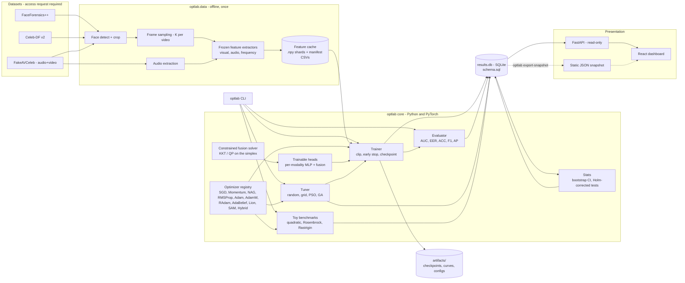
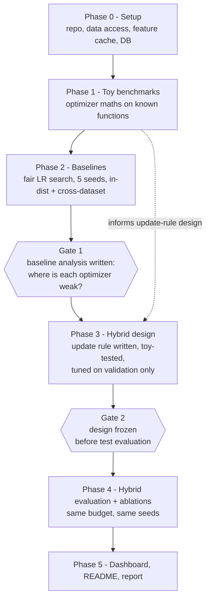
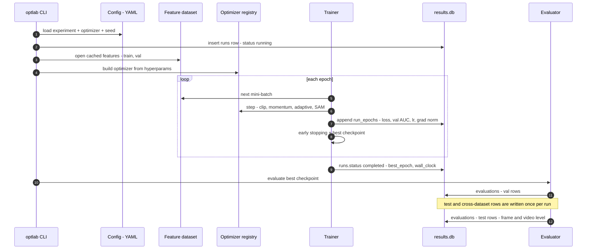
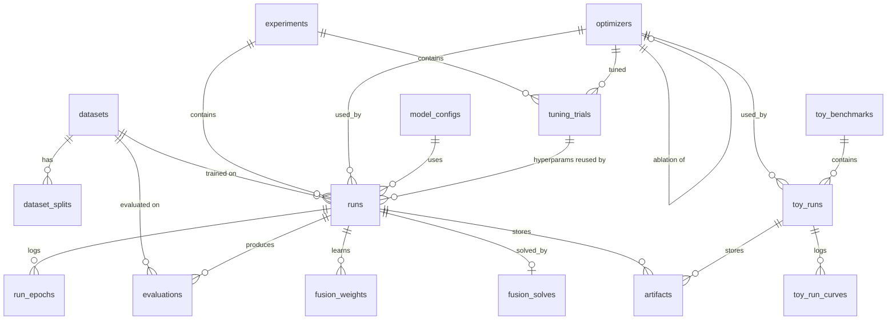
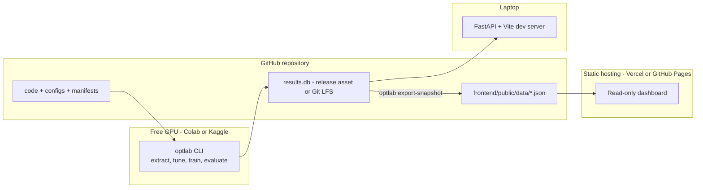

# System Architecture

> Diagrams are Mermaid and render natively on GitHub. Names match `backend/schema.sql` and `docs/TRD.md`.

## 1. System context

Heavy compute (feature extraction, training) runs offline on a free GPU (Colab / Kaggle). Everything it produces lands in one SQLite file plus a few artifact folders. The dashboard only reads that file, so it can run locally or be deployed as a static site from a JSON snapshot.

## 2. Experiment phases and gates

The hybrid optimizer is designed only after baseline analysis, and its design is frozen before any test-split number is looked at.

## 3. One training run

## 4. Data model

Simplified view of `backend/schema.sql`.

## 5. Runtime and deployment

## 6. Design decisions

| Decision | Reason |
|---|---|
| Frozen backbones with cached features | Optimizer runs train only small heads, so 10 optimizers x 5 seeds x tuning fits on a free GPU. Trade-off: findings may not transfer to full fine-tuning, so Phase 4 includes an "unfreeze last N layers" ablation. |
| SQLite results store | One file, no server, easy to version and share. Postgres-portable. |
| Read-only dashboard | Results are produced offline; no auth or write path to secure. |
| Static JSON snapshot | Lets the dashboard be hosted for free and keeps the repo demo-able without a backend. |
| Test splits written once | Prevents tuning the hybrid optimizer against the benchmark it is judged on. |
| Std-dev computed in the API layer | SQLite math functions are optional; views expose variance instead. |
