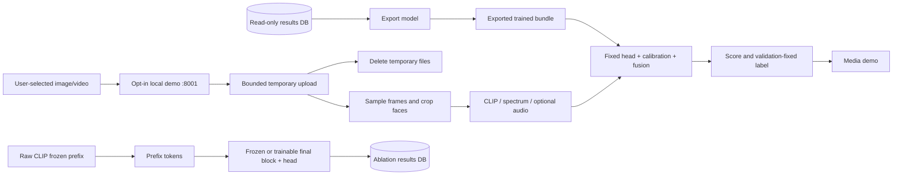

# Additional research workflows

These commands run from the repository root after the README setup. Raw datasets, cached
features, model bundles and checkpoints stay local and are excluded from Git.

## Experimental hybrid

The design and constants were committed in `5155285` before its TIMIT study. Read
[HYBRID_DESIGN.md](HYBRID_DESIGN.md) for equations, component removals and budget rules.
It combines known methods; neither originality nor improved detection follows from combining them.

```bash
optlab init-db --toy-config configs/experiments/hybrid_toy.yaml
optlab toy --config configs/experiments/hybrid_toy.yaml
optlab toy-report --config configs/experiments/hybrid_toy.yaml --out results/hybrid_toy --summary results/hybrid_toy_summary.md
optlab cv --experiment hybrid_timit_cv
optlab cv-stats --experiment hybrid_timit_cv
```

The primary comparison uses eight identity-component folds, five seeds, seven optimizer
variants, 20 tuning trials of 10 epochs, and up to 30 final epochs. Each fold holds out
four people, covering all 32. HQ and degraded LQ contain the same source identities and
are reported separately. LQ is a degradation test, not an unseen manipulation dataset.
Seed means within folds are the replicates for paired comparisons; video frames are not
independent experimental replicates. TIMIT had already been observed, so this is exploratory.

## Joint MLP and linear SVM

```bash
optlab sweep --experiment hybrid_heads_weighted_sum
optlab sweep --experiment hybrid_heads_concat_mlp
optlab sweep --experiment hybrid_heads_svm_head
```

Each uses visual and frequency features, AdamW and the full hybrid, five seeds and the
same search/training budget. Joint inputs are standardized using training features only;
the persisted buffers are reused at validation, test and inference. Validation-tune fixes
score calibration and thresholds; validation-fusion fits fusion parameters.

The SVM minimizes the primal `0.5 ||w||² + C/n sum(max(0, 1-y_i(wᵀx_i+b)))` with
labels mapped to ±1 and an unpenalized bias in that explicit objective. Its corresponding
dual maximizes `sum(alpha) - 0.5 sum(alpha_i alpha_j y_i y_j x_iᵀx_j)`, subject to
`0 <= alpha_i <= C/n` and `sum(alpha_i y_i)=0`. This implementation trains the primal
by the selected optimizer, rather than solving a dual QP. Optimizer weight decay can
add regularization beyond the explicit primal penalty. `svm_c` is fixed in model YAML.

## Limited backbone fine-tuning

```bash
optlab finetune --config configs/experiments/finetune_timit.yaml
```

The checked-in execution config uses Apple MPS. Set `device: cpu` or `device: cuda` in
a separately named config/experiment for other machines. It compares frozen CLIP with
an updated final transformer block, final layer norm and projection, using the same
sampled face, MLP, three seeds, AdamW/hybrid, fixed LR 1e-4, three epochs and batch 16.
This is a 12-run feasibility ablation, not the primary 20-trial study. One frame per video
limits cost. Frozen prefix tokens are cached before the final block; outputs of trainable
layers are never cached. Checkpoints record whether backbone block parameters changed.
The generic `optlab stats` groups by optimizer; use the Hybrid dashboard/phase report for
this multi-model experiment so frozen and thawed models remain separate.

## Images and licensed multimodal datasets

Access is required before an external study can be run. The adapter accepts an explicit
CSV with columns `video_id,path,label,method,identity_id` (0=real, 1=manipulated). Paths
must resolve to existing files beneath the supplied root. Include every donor and target
identity joined with `+`; leave split/validation roles absent or empty. Connected identity
components are assigned together to avoid leakage. Do not infer donor identities from
filenames. The author-provided FakeAVCeleb layout has not been verified locally.

```bash
optlab prepare --dataset fakeavceleb --root /path/to/licensed-media --metadata /path/to/metadata.csv
optlab extract --dataset fakeavceleb --backbone clip_vit_b16 --root /path/to/licensed-media
optlab extract --dataset fakeavceleb --backbone wav2vec2_base --root /path/to/licensed-media
optlab sweep --experiment hybrid_fakeavceleb

optlab prepare --dataset user_images --root /path/to/images --metadata /path/to/images.csv
optlab extract --dataset user_images --backbone clip_vit_b16 --root /path/to/images --images
optlab sweep --experiment hybrid_images
```

Images use one EXIF-corrected RGB frame, face detection and visual/frequency streams.
An image corpus is not included, so standalone image detection accuracy is unmeasured.
Existing FF++ and Celeb-DF preparation commands are in the README; the harder unseen
cross-dataset study still requires licensed copies and real-layout verification. Once both
feature caches exist, run `optlab sweep --experiment hybrid_external` for the frozen hybrid
and ablations, alongside `calibrated_external` for the wider baseline suite.

## Local prediction

Choose a completed **visual/frequency** run for both images and videos. Models requiring
audio reject still images; the system never silently fills missing modalities.

```bash
optlab export-model --run-id RUN_ID --out artifacts/demo/model.pt
optlab predict --bundle artifacts/demo/model.pt --input /path/to/media.png --device cpu
optlab demo --bundle artifacts/demo/model.pt --host 127.0.0.1 --port 8001 --cors-origin http://127.0.0.1:5173
```

Open the dashboard's **Media demo**. It checks the local service automatically; select a
file, then press **Analyze media**. Use **Retry connection** if the service was unavailable.
Use `--cors-origin http://localhost:5173` when visiting localhost instead. Configure another
service URL through frontend `VITE_DEMO_API_URL` before building. Model export supports
cached-head runs, including joint MLP/SVM; the raw fine-tuning runner has a different
checkpoint schema and is not an export target.

The bundle stores weights, training normalization, validation calibration, fusion weights
and validation-fixed frame/video thresholds. Prediction never fits transforms on uploads.
The demo's `GET /demo/health` and `POST /demo/predict` are separate from the read-only
results API. Uploads are bounded to 25 MiB and stored in a temporary directory removed
on success or failure. Inference is serialized; access logs are disabled by the CLI.
Run it on loopback for local research. It has no authentication or deployment hardening.
A sigmoid score is a detector output, not a verified probability of authenticity.



Regenerate the consolidated report with `optlab phase-report`, then refresh frontend data
with `optlab export-snapshot`. Run one writing study per database at a time; completed runs
resume without being retrained. SQLite waits up to 30 seconds for transient writer locks.
