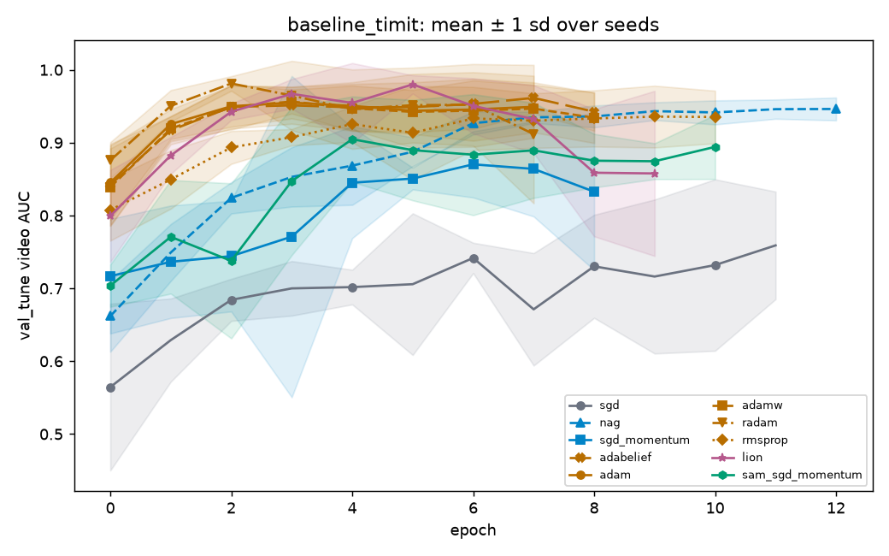

# baseline_timit: statistics

_Generated by `optlab stats` from the results database on 2026-10-14 03:35 UTC. Code version `9586cfc7801ffc286a245f45f75746be14020f49-dirty`._

**Hypothesis (recorded before the runs):** Adaptive optimizers converge faster but show a larger HQ-to-LQ generalization gap than SGD with momentum; SAM narrows the gap. The fitted fusion weight on audio is near zero for every optimizer.

## Runs and tuning budget

| optimizer | completed | diverged | failed | tuning trials |
|---|---|---|---|---|
| sgd | 5 | 0 | 0 | 20 (random, 0 diverged) |
| nag | 5 | 0 | 0 | 20 (random, 0 diverged) |
| sgd_momentum | 5 | 0 | 0 | 20 (random, 0 diverged) |
| adabelief | 5 | 0 | 0 | 20 (random, 0 diverged) |
| adam | 5 | 0 | 0 | 20 (random, 0 diverged) |
| adamw | 5 | 0 | 0 | 20 (random, 0 diverged) |
| radam | 5 | 0 | 0 | 20 (random, 0 diverged) |
| rmsprop | 5 | 0 | 0 | 20 (random, 0 diverged) |
| lion | 5 | 0 | 0 | 20 (random, 0 diverged) |
| sam_sgd_momentum | 5 | 0 | 0 | 20 (random, 0 diverged) |

## Test AUC: optlab_timit_hq (in_distribution, frame level)

| optimizer | n seeds | AUC mean ± sd | 95% CI | EER mean | fit time (s) |
|---|---|---|---|---|---|
| nag | 5 | 0.7532 ± 0.0251 | [0.7341, 0.7709] | 0.3143 | 1.6 |
| radam | 5 | 0.7517 ± 0.0242 | [0.7342, 0.7692] | 0.3214 | 2.6 |
| adam | 5 | 0.7495 ± 0.0273 | [0.7284, 0.7705] | 0.3240 | 2.1 |
| adamw | 5 | 0.7426 ± 0.0368 | [0.7093, 0.7667] | 0.3329 | 1.5 |
| lion | 5 | 0.7136 ± 0.0499 | [0.6773, 0.7554] | 0.3593 | 1.5 |
| rmsprop | 5 | 0.6988 ± 0.0454 | [0.6629, 0.7328] | 0.3753 | 1.8 |
| adabelief | 5 | 0.6957 ± 0.0419 | [0.6635, 0.7280] | 0.3758 | 4.2 |
| sam_sgd_momentum | 5 | 0.6957 ± 0.0128 | [0.6851, 0.7047] | 0.3693 | 2.9 |
| sgd_momentum | 5 | 0.6610 ± 0.0467 | [0.6323, 0.7012] | 0.3915 | 1.2 |
| sgd | 5 | 0.6307 ± 0.0427 | [0.5975, 0.6640] | 0.4212 | 1.8 |

## Test AUC: optlab_timit_hq (in_distribution, video level)

| optimizer | n seeds | AUC mean ± sd | 95% CI | EER mean | fit time (s) |
|---|---|---|---|---|---|
| radam | 5 | 0.7695 ± 0.0278 | [0.7489, 0.7899] | 0.3114 | 2.6 |
| nag | 5 | 0.7668 ± 0.0275 | [0.7433, 0.7849] | 0.3062 | 1.6 |
| adam | 5 | 0.7597 ± 0.0318 | [0.7352, 0.7842] | 0.3276 | 2.1 |
| adamw | 5 | 0.7567 ± 0.0449 | [0.7157, 0.7860] | 0.3257 | 1.5 |
| lion | 5 | 0.7231 ± 0.0548 | [0.6835, 0.7690] | 0.3724 | 1.5 |
| sam_sgd_momentum | 5 | 0.7091 ± 0.0167 | [0.6950, 0.7210] | 0.3638 | 2.9 |
| rmsprop | 5 | 0.7068 ± 0.0490 | [0.6688, 0.7439] | 0.3843 | 1.8 |
| adabelief | 5 | 0.7048 ± 0.0495 | [0.6673, 0.7422] | 0.3714 | 4.2 |
| sgd_momentum | 5 | 0.6739 ± 0.0485 | [0.6407, 0.7132] | 0.3867 | 1.2 |
| sgd | 5 | 0.6388 ± 0.0490 | [0.6002, 0.6773] | 0.4190 | 1.8 |

### Pairwise, optlab_timit_hq video AUC

0 of 45 pairs distinguishable; the rest are within seed noise.

| a | b | mean diff | 95% CI | Cohen's d | Holm p | verdict |
|---|---|---|---|---|---|---|
| radam | nag | 0.0028 | [-0.0271, 0.0334] | 0.10 | 1.000 | within noise |
| radam | adam | 0.0098 | [-0.0237, 0.0423] | 0.33 | 1.000 | within noise |
| radam | adamw | 0.0128 | [-0.0245, 0.0562] | 0.34 | 1.000 | within noise |
| radam | lion | 0.0464 | [-0.0050, 0.0918] | 1.07 | 1.000 | within noise |
| radam | sam_sgd_momentum | 0.0604 | [0.0353, 0.0852] | 2.64 | 0.198 | within noise |
| radam | rmsprop | 0.0627 | [0.0199, 0.1071] | 1.58 | 1.000 | within noise |
| radam | adabelief | 0.0648 | [0.0199, 0.1091] | 1.61 | 1.000 | within noise |
| radam | sgd_momentum | 0.0957 | [0.0490, 0.1360] | 2.42 | 0.301 | within noise |
| radam | sgd | 0.1308 | [0.0872, 0.1754] | 3.29 | 0.077 | within noise |
| nag | adam | 0.0070 | [-0.0270, 0.0389] | 0.24 | 1.000 | within noise |
| nag | adamw | 0.0100 | [-0.0281, 0.0537] | 0.27 | 1.000 | within noise |
| nag | lion | 0.0436 | [-0.0079, 0.0886] | 1.01 | 1.000 | within noise |
| nag | sam_sgd_momentum | 0.0577 | [0.0319, 0.0815] | 2.54 | 0.231 | within noise |
| nag | rmsprop | 0.0600 | [0.0160, 0.1043] | 1.51 | 1.000 | within noise |
| nag | adabelief | 0.0620 | [0.0170, 0.1053] | 1.55 | 1.000 | within noise |
| nag | sgd_momentum | 0.0929 | [0.0467, 0.1323] | 2.36 | 0.336 | within noise |
| nag | sgd | 0.1280 | [0.0847, 0.1713] | 3.22 | 0.085 | within noise |
| adam | adamw | 0.0030 | [-0.0365, 0.0487] | 0.08 | 1.000 | within noise |
| adam | lion | 0.0366 | [-0.0148, 0.0839] | 0.82 | 1.000 | within noise |
| adam | sam_sgd_momentum | 0.0506 | [0.0230, 0.0786] | 1.99 | 0.707 | within noise |
| adam | rmsprop | 0.0529 | [0.0077, 0.1000] | 1.28 | 1.000 | within noise |
| adam | adabelief | 0.0550 | [0.0082, 0.0998] | 1.32 | 1.000 | within noise |
| adam | sgd_momentum | 0.0859 | [0.0384, 0.1283] | 2.09 | 0.487 | within noise |
| adam | sgd | 0.1210 | [0.0767, 0.1664] | 2.93 | 0.108 | within noise |
| adamw | lion | 0.0336 | [-0.0250, 0.0850] | 0.67 | 1.000 | within noise |
| adamw | sam_sgd_momentum | 0.0476 | [0.0075, 0.0803] | 1.41 | 1.000 | within noise |
| adamw | rmsprop | 0.0499 | [-0.0047, 0.1001] | 1.06 | 1.000 | within noise |
| adamw | adabelief | 0.0520 | [-0.0030, 0.1021] | 1.10 | 1.000 | within noise |
| adamw | sgd_momentum | 0.0829 | [0.0278, 0.1299] | 1.77 | 0.811 | within noise |
| adamw | sgd | 0.1180 | [0.0649, 0.1684] | 2.51 | 0.175 | within noise |
| lion | sam_sgd_momentum | 0.0140 | [-0.0273, 0.0624] | 0.35 | 1.000 | within noise |
| lion | rmsprop | 0.0163 | [-0.0394, 0.0766] | 0.31 | 1.000 | within noise |
| lion | adabelief | 0.0184 | [-0.0390, 0.0775] | 0.35 | 1.000 | within noise |
| lion | sgd_momentum | 0.0493 | [-0.0067, 0.1065] | 0.95 | 1.000 | within noise |
| lion | sgd | 0.0844 | [0.0290, 0.1439] | 1.62 | 1.000 | within noise |
| sam_sgd_momentum | rmsprop | 0.0023 | [-0.0361, 0.0439] | 0.06 | 1.000 | within noise |
| sam_sgd_momentum | adabelief | 0.0043 | [-0.0373, 0.0444] | 0.12 | 1.000 | within noise |
| sam_sgd_momentum | sgd_momentum | 0.0352 | [-0.0073, 0.0715] | 0.97 | 1.000 | within noise |
| sam_sgd_momentum | sgd | 0.0703 | [0.0304, 0.1107] | 1.92 | 0.998 | within noise |
| rmsprop | adabelief | 0.0020 | [-0.0535, 0.0550] | 0.04 | 1.000 | within noise |
| rmsprop | sgd_momentum | 0.0330 | [-0.0236, 0.0832] | 0.68 | 1.000 | within noise |
| rmsprop | sgd | 0.0680 | [0.0152, 0.1207] | 1.39 | 1.000 | within noise |
| adabelief | sgd_momentum | 0.0309 | [-0.0247, 0.0828] | 0.63 | 1.000 | within noise |
| adabelief | sgd | 0.0660 | [0.0131, 0.1207] | 1.34 | 1.000 | within noise |
| sgd_momentum | sgd | 0.0351 | [-0.0161, 0.0909] | 0.72 | 1.000 | within noise |

## Test AUC: optlab_timit_lq (cross_dataset, frame level)

| optimizer | n seeds | AUC mean ± sd | 95% CI | EER mean | fit time (s) |
|---|---|---|---|---|---|
| radam | 5 | 0.8748 ± 0.0307 | [0.8499, 0.8956] | 0.2180 | 2.6 |
| adam | 5 | 0.8703 ± 0.0347 | [0.8444, 0.8985] | 0.2191 | 2.1 |
| adamw | 5 | 0.8604 ± 0.0467 | [0.8179, 0.8870] | 0.2360 | 1.5 |
| nag | 5 | 0.8583 ± 0.0283 | [0.8364, 0.8804] | 0.2329 | 1.6 |
| lion | 5 | 0.8263 ± 0.0636 | [0.7793, 0.8729] | 0.2662 | 1.5 |
| adabelief | 5 | 0.8037 ± 0.0530 | [0.7653, 0.8423] | 0.2938 | 4.2 |
| sam_sgd_momentum | 5 | 0.7983 ± 0.0407 | [0.7673, 0.8292] | 0.2979 | 2.9 |
| rmsprop | 5 | 0.7889 ± 0.0607 | [0.7415, 0.8345] | 0.3118 | 1.8 |
| sgd_momentum | 5 | 0.7759 ± 0.0777 | [0.7150, 0.8368] | 0.3051 | 1.2 |
| sgd | 5 | 0.7064 ± 0.0630 | [0.6597, 0.7531] | 0.3813 | 1.8 |

## Test AUC: optlab_timit_lq (cross_dataset, video level)

| optimizer | n seeds | AUC mean ± sd | 95% CI | EER mean | fit time (s) |
|---|---|---|---|---|---|
| radam | 5 | 0.8943 ± 0.0366 | [0.8634, 0.9183] | 0.2086 | 2.6 |
| adam | 5 | 0.8889 ± 0.0390 | [0.8593, 0.9184] | 0.2024 | 2.1 |
| nag | 5 | 0.8797 ± 0.0345 | [0.8525, 0.9069] | 0.2210 | 1.6 |
| adamw | 5 | 0.8785 ± 0.0524 | [0.8316, 0.9081] | 0.2200 | 1.5 |
| lion | 5 | 0.8407 ± 0.0707 | [0.7869, 0.8927] | 0.2457 | 1.5 |
| adabelief | 5 | 0.8141 ± 0.0623 | [0.7692, 0.8602] | 0.2800 | 4.2 |
| sam_sgd_momentum | 5 | 0.8103 ± 0.0479 | [0.7742, 0.8474] | 0.2895 | 2.9 |
| rmsprop | 5 | 0.8025 ± 0.0687 | [0.7490, 0.8534] | 0.3000 | 1.8 |
| sgd_momentum | 5 | 0.7943 ± 0.0894 | [0.7242, 0.8645] | 0.2933 | 1.2 |
| sgd | 5 | 0.7161 ± 0.0681 | [0.6662, 0.7680] | 0.3838 | 1.8 |

### Pairwise, optlab_timit_lq video AUC

0 of 45 pairs distinguishable; the rest are within seed noise.

| a | b | mean diff | 95% CI | Cohen's d | Holm p | verdict |
|---|---|---|---|---|---|---|
| radam | adam | 0.0055 | [-0.0388, 0.0446] | 0.14 | 1.000 | within noise |
| radam | nag | 0.0147 | [-0.0265, 0.0509] | 0.41 | 1.000 | within noise |
| radam | adamw | 0.0159 | [-0.0304, 0.0677] | 0.35 | 1.000 | within noise |
| radam | lion | 0.0536 | [-0.0087, 0.1153] | 0.95 | 1.000 | within noise |
| radam | adabelief | 0.0802 | [0.0209, 0.1350] | 1.57 | 1.000 | within noise |
| radam | sam_sgd_momentum | 0.0840 | [0.0369, 0.1309] | 1.97 | 0.637 | within noise |
| radam | rmsprop | 0.0919 | [0.0317, 0.1516] | 1.67 | 1.000 | within noise |
| radam | sgd_momentum | 0.1000 | [0.0256, 0.1757] | 1.46 | 1.000 | within noise |
| radam | sgd | 0.1782 | [0.1179, 0.2392] | 3.26 | 0.089 | within noise |
| adam | nag | 0.0092 | [-0.0319, 0.0508] | 0.25 | 1.000 | within noise |
| adam | adamw | 0.0104 | [-0.0357, 0.0658] | 0.22 | 1.000 | within noise |
| adam | lion | 0.0481 | [-0.0153, 0.1116] | 0.84 | 1.000 | within noise |
| adam | adabelief | 0.0747 | [0.0154, 0.1309] | 1.44 | 1.000 | within noise |
| adam | sam_sgd_momentum | 0.0786 | [0.0313, 0.1276] | 1.80 | 0.881 | within noise |
| adam | rmsprop | 0.0864 | [0.0242, 0.1494] | 1.55 | 1.000 | within noise |
| adam | sgd_momentum | 0.0945 | [0.0224, 0.1723] | 1.37 | 1.000 | within noise |
| adam | sgd | 0.1727 | [0.1125, 0.2349] | 3.11 | 0.098 | within noise |
| nag | adamw | 0.0012 | [-0.0427, 0.0540] | 0.03 | 1.000 | within noise |
| nag | lion | 0.0390 | [-0.0220, 0.1005] | 0.70 | 1.000 | within noise |
| nag | adabelief | 0.0655 | [0.0079, 0.1197] | 1.30 | 1.000 | within noise |
| nag | sam_sgd_momentum | 0.0694 | [0.0243, 0.1164] | 1.66 | 1.000 | within noise |
| nag | rmsprop | 0.0772 | [0.0180, 0.1382] | 1.42 | 1.000 | within noise |
| nag | sgd_momentum | 0.0853 | [0.0119, 0.1608] | 1.26 | 1.000 | within noise |
| nag | sgd | 0.1635 | [0.1055, 0.2230] | 3.03 | 0.135 | within noise |
| adamw | lion | 0.0378 | [-0.0327, 0.1041] | 0.61 | 1.000 | within noise |
| adamw | adabelief | 0.0643 | [-0.0031, 0.1245] | 1.12 | 1.000 | within noise |
| adamw | sam_sgd_momentum | 0.0682 | [0.0115, 0.1212] | 1.36 | 1.000 | within noise |
| adamw | rmsprop | 0.0760 | [0.0064, 0.1402] | 1.24 | 1.000 | within noise |
| adamw | sgd_momentum | 0.0841 | [0.0032, 0.1650] | 1.15 | 1.000 | within noise |
| adamw | sgd | 0.1623 | [0.0938, 0.2286] | 2.67 | 0.140 | within noise |
| lion | adabelief | 0.0266 | [-0.0500, 0.0985] | 0.40 | 1.000 | within noise |
| lion | sam_sgd_momentum | 0.0304 | [-0.0371, 0.0971] | 0.50 | 1.000 | within noise |
| lion | rmsprop | 0.0382 | [-0.0388, 0.1160] | 0.55 | 1.000 | within noise |
| lion | sgd_momentum | 0.0464 | [-0.0406, 0.1352] | 0.58 | 1.000 | within noise |
| lion | sgd | 0.1246 | [0.0481, 0.2008] | 1.80 | 0.875 | within noise |
| adabelief | sam_sgd_momentum | 0.0039 | [-0.0550, 0.0658] | 0.07 | 1.000 | within noise |
| adabelief | rmsprop | 0.0117 | [-0.0606, 0.0837] | 0.18 | 1.000 | within noise |
| adabelief | sgd_momentum | 0.0198 | [-0.0643, 0.1039] | 0.26 | 1.000 | within noise |
| adabelief | sgd | 0.0980 | [0.0285, 0.1724] | 1.50 | 1.000 | within noise |
| sam_sgd_momentum | rmsprop | 0.0078 | [-0.0579, 0.0743] | 0.13 | 1.000 | within noise |
| sam_sgd_momentum | sgd_momentum | 0.0160 | [-0.0627, 0.0961] | 0.22 | 1.000 | within noise |
| sam_sgd_momentum | sgd | 0.0941 | [0.0288, 0.1595] | 1.60 | 1.000 | within noise |
| rmsprop | sgd_momentum | 0.0081 | [-0.0797, 0.0964] | 0.10 | 1.000 | within noise |
| rmsprop | sgd | 0.0863 | [0.0126, 0.1608] | 1.26 | 1.000 | within noise |
| sgd_momentum | sgd | 0.0782 | [-0.0078, 0.1660] | 0.98 | 1.000 | within noise |

## Generalization gap (in-distribution − cross-dataset test AUC, video)

| optimizer | n | gap mean ± sd | 95% CI |
|---|---|---|---|
| adam | 5 | -0.1291 ± 0.0155 | [-0.1409, -0.1167] |
| radam | 5 | -0.1248 ± 0.0144 | [-0.1347, -0.1123] |
| adamw | 5 | -0.1218 ± 0.0093 | [-0.1285, -0.1136] |
| sgd_momentum | 5 | -0.1205 ± 0.0538 | [-0.1632, -0.0784] |
| lion | 5 | -0.1176 ± 0.0255 | [-0.1364, -0.0969] |
| nag | 5 | -0.1129 ± 0.0203 | [-0.1284, -0.0972] |
| adabelief | 5 | -0.1094 ± 0.0149 | [-0.1227, -0.1002] |
| sam_sgd_momentum | 5 | -0.1012 ± 0.0327 | [-0.1266, -0.0758] |
| rmsprop | 5 | -0.0957 ± 0.0286 | [-0.1179, -0.0734] |
| sgd | 5 | -0.0774 ± 0.0251 | [-0.0961, -0.0575] |

## Convergence (val_tune; target = 0.95 × best mean peak AUC)

| optimizer | epochs to val AUC ≥ 0.9412 | seeds reaching it | area under val loss | ≈ wall clock to target (s) | divergence rate |
|---|---|---|---|---|---|
| sgd | 20.0 | 1/5 | 42.881 | 1.9 | 0/5 |
| nag | 7.5 | 4/5 | 33.426 | 0.8 | 0/5 |
| sgd_momentum | 4.0 | 3/5 | 26.146 | 0.7 | 0/5 |
| adabelief | 2.0 | 5/5 | 22.043 | 1.8 | 0/5 |
| adam | 2.0 | 4/5 | 20.225 | 0.7 | 0/5 |
| adamw | 2.0 | 3/5 | 17.803 | 0.4 | 0/5 |
| radam | 1.0 | 5/5 | 23.432 | 0.7 | 0/5 |
| rmsprop | 4.0 | 3/5 | 31.161 | 0.6 | 0/5 |
| lion | 2.0 | 5/5 | 32.485 | 0.4 | 0/5 |
| sam_sgd_momentum | 4.5 | 4/5 | 24.735 | 1.6 | 0/5 |

