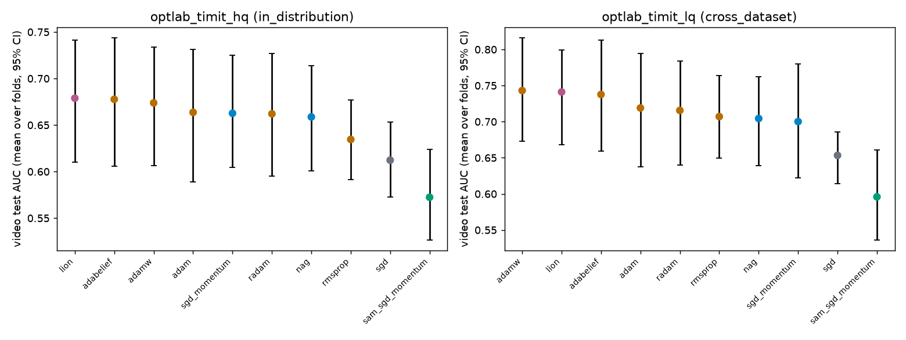

# calibrated_timit_cv: cross-validated statistics

_Generated by `optlab cv-stats` from the results database on 2026-10-15 15:43 UTC._

Runs by status: completed 400.

One fold = one held-out group of people; per fold, AUC is averaged over seeds, and optimizers are compared paired by fold.

## optlab_timit_hq (in_distribution): video test AUC across folds

| optimizer | folds | AUC mean ± sd over folds | 95% CI |
|---|---|---|---|
| lion | 8 | 0.6789 ± 0.1019 | [0.6099, 0.7412] |
| adabelief | 8 | 0.6777 ± 0.1062 | [0.6055, 0.7440] |
| adamw | 8 | 0.6738 ± 0.0990 | [0.6067, 0.7340] |
| adam | 8 | 0.6637 ± 0.1113 | [0.5888, 0.7311] |
| sgd_momentum | 8 | 0.6626 ± 0.0913 | [0.6046, 0.7250] |
| radam | 8 | 0.6621 ± 0.1029 | [0.5952, 0.7269] |
| nag | 8 | 0.6587 ± 0.0877 | [0.6009, 0.7136] |
| rmsprop | 8 | 0.6346 ± 0.0661 | [0.5915, 0.6769] |
| sgd | 8 | 0.6123 ± 0.0632 | [0.5726, 0.6530] |
| sam_sgd_momentum | 8 | 0.5724 ± 0.0760 | [0.5264, 0.6237] |

**Paired comparisons:** 0 of 45 pairs distinguishable. Strongest ten by Holm p:

| a | b | folds | mean diff | 95% CI | paired d | Holm p | verdict |
|---|---|---|---|---|---|---|---|
| lion | sam_sgd_momentum | 8 | 0.1064 | [0.0541, 0.1563] | 1.35 | 0.299 | within noise |
| adamw | sam_sgd_momentum | 8 | 0.1014 | [0.0458, 0.1621] | 1.11 | 0.731 | within noise |
| radam | sam_sgd_momentum | 8 | 0.0896 | [0.0413, 0.1458] | 1.09 | 0.752 | within noise |
| adabelief | sam_sgd_momentum | 8 | 0.1053 | [0.0424, 0.1735] | 1.03 | 0.959 | within noise |
| sgd | sgd_momentum | 8 | -0.0504 | [-0.1075, 0.0007] | -0.61 | 1.000 | within noise |
| sgd | nag | 8 | -0.0465 | [-0.0893, -0.0029] | -0.69 | 1.000 | within noise |
| sgd | rmsprop | 8 | -0.0223 | [-0.0666, 0.0251] | -0.32 | 1.000 | within noise |
| sgd | adam | 8 | -0.0514 | [-0.1316, 0.0321] | -0.41 | 1.000 | within noise |
| sgd | adamw | 8 | -0.0615 | [-0.1315, 0.0155] | -0.54 | 1.000 | within noise |
| sgd | radam | 8 | -0.0498 | [-0.1206, 0.0264] | -0.43 | 1.000 | within noise |

## optlab_timit_lq (cross_dataset): video test AUC across folds

| optimizer | folds | AUC mean ± sd over folds | 95% CI |
|---|---|---|---|
| adamw | 8 | 0.7431 ± 0.1102 | [0.6725, 0.8164] |
| lion | 8 | 0.7411 ± 0.1017 | [0.6683, 0.7992] |
| adabelief | 8 | 0.7377 ± 0.1196 | [0.6590, 0.8131] |
| adam | 8 | 0.7190 ± 0.1222 | [0.6378, 0.7942] |
| radam | 8 | 0.7156 ± 0.1120 | [0.6403, 0.7843] |
| rmsprop | 8 | 0.7071 ± 0.0889 | [0.6497, 0.7640] |
| nag | 8 | 0.7044 ± 0.0948 | [0.6390, 0.7626] |
| sgd_momentum | 8 | 0.7001 ± 0.1215 | [0.6221, 0.7803] |
| sgd | 8 | 0.6534 ± 0.0553 | [0.6143, 0.6861] |
| sam_sgd_momentum | 8 | 0.5959 ± 0.0985 | [0.5360, 0.6611] |

**Paired comparisons:** 0 of 45 pairs distinguishable. Strongest ten by Holm p:

| a | b | folds | mean diff | 95% CI | paired d | Holm p | verdict |
|---|---|---|---|---|---|---|---|
| lion | sam_sgd_momentum | 8 | 0.1452 | [0.0861, 0.2045] | 1.59 | 0.128 | within noise |
| radam | sam_sgd_momentum | 8 | 0.1197 | [0.0652, 0.1797] | 1.32 | 0.322 | within noise |
| adamw | sam_sgd_momentum | 8 | 0.1472 | [0.0831, 0.2269] | 1.29 | 0.358 | within noise |
| adabelief | sam_sgd_momentum | 8 | 0.1418 | [0.0695, 0.2259] | 1.15 | 0.593 | within noise |
| adam | sam_sgd_momentum | 8 | 0.1231 | [0.0564, 0.1994] | 1.09 | 0.742 | within noise |
| nag | sam_sgd_momentum | 8 | 0.1085 | [0.0472, 0.1742] | 1.07 | 0.759 | within noise |
| sgd | sgd_momentum | 8 | -0.0468 | [-0.1149, 0.0198] | -0.45 | 1.000 | within noise |
| sgd | nag | 8 | -0.0510 | [-0.0998, 0.0017] | -0.65 | 1.000 | within noise |
| sgd | rmsprop | 8 | -0.0537 | [-0.0930, -0.0123] | -0.85 | 1.000 | within noise |
| sgd | adam | 8 | -0.0657 | [-0.1447, 0.0169] | -0.52 | 1.000 | within noise |

## Fusion: mixing weight vs contribution (all runs, all folds)

Contribution = the share of the fused logit's spread on val_fusion that a stream supplies (w_m · sd(z_m) / Σ).

| stream | mean weight | mean contribution | runs |
|---|---|---|---|
| visual | 0.868 | 0.973 | 400 |
| frequency | 0.090 | 0.020 | 400 |
| audio | 0.042 | 0.007 | 400 |
