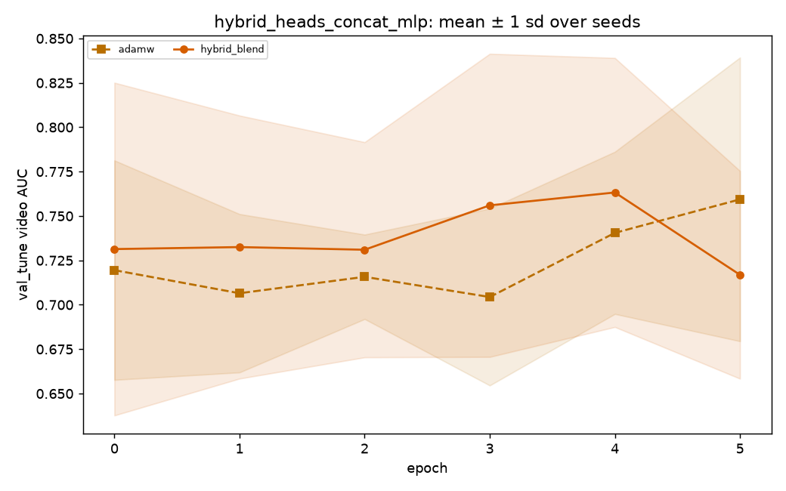

# hybrid_heads_concat_mlp: statistics

_Generated by `optlab stats` from the results database on 2026-10-16 02:54 UTC. Code version `5155285d034174bd4b3f585ecf86b1dabfa79480-dirty`._

**Hypothesis (recorded before the runs):** RMS-matched Adam/momentum with Lookahead improves validation stability; test superiority is unknown. Compare the full hybrid to each removed component and three established baselines at equal tuning budgets.

## Runs and tuning budget

| optimizer | completed | diverged | failed | tuning trials |
|---|---|---|---|---|
| adamw | 5 | 0 | 0 | 20 (random, 0 diverged) |
| hybrid_blend | 5 | 0 | 0 | 20 (random, 0 diverged) |

## Test AUC: optlab_timit_hq (in_distribution, frame level)

| optimizer | n seeds | AUC mean ± sd | 95% CI | EER mean | fit time (s) |
|---|---|---|---|---|---|
| hybrid_blend | 5 | 0.7988 ± 0.0549 | [0.7571, 0.8422] | 0.2781 | 0.6 |
| adamw | 5 | 0.7985 ± 0.0416 | [0.7662, 0.8308] | 0.3075 | 0.6 |

## Test AUC: optlab_timit_hq (in_distribution, video level)

| optimizer | n seeds | AUC mean ± sd | 95% CI | EER mean | fit time (s) |
|---|---|---|---|---|---|
| hybrid_blend | 5 | 0.8116 ± 0.0541 | [0.7715, 0.8545] | 0.2550 | 0.6 |
| adamw | 5 | 0.8054 ± 0.0424 | [0.7730, 0.8377] | 0.2850 | 0.6 |

### Pairwise, optlab_timit_hq video AUC

0 of 1 pairs distinguishable; the rest are within seed noise.

| a | b | mean diff | 95% CI | Cohen's d | Holm p | verdict |
|---|---|---|---|---|---|---|
| hybrid_blend | adamw | 0.0062 | [-0.0476, 0.0594] | 0.13 | 0.844 | within noise |

## Test AUC: optlab_timit_lq (cross_dataset, frame level)

| optimizer | n seeds | AUC mean ± sd | 95% CI | EER mean | fit time (s) |
|---|---|---|---|---|---|
| hybrid_blend | 5 | 0.8667 ± 0.0505 | [0.8277, 0.9044] | 0.2475 | 0.6 |
| adamw | 5 | 0.8589 ± 0.0281 | [0.8369, 0.8810] | 0.2447 | 0.6 |

## Test AUC: optlab_timit_lq (cross_dataset, video level)

| optimizer | n seeds | AUC mean ± sd | 95% CI | EER mean | fit time (s) |
|---|---|---|---|---|---|
| hybrid_blend | 5 | 0.8750 ± 0.0513 | [0.8357, 0.9143] | 0.2450 | 0.6 |
| adamw | 5 | 0.8626 ± 0.0349 | [0.8352, 0.8900] | 0.2450 | 0.6 |

### Pairwise, optlab_timit_lq video AUC

0 of 1 pairs distinguishable; the rest are within seed noise.

| a | b | mean diff | 95% CI | Cohen's d | Holm p | verdict |
|---|---|---|---|---|---|---|
| hybrid_blend | adamw | 0.0124 | [-0.0366, 0.0604] | 0.28 | 0.669 | within noise |

## Generalization gap (in-distribution − cross-dataset test AUC, video)

Each comparison uses only seeds evaluated on both datasets.

| optimizer | in-distribution dataset | comparison dataset | paired seeds | gap mean ± sd | 95% CI |
|---|---|---|---|---|---|
| hybrid_blend | optlab_timit_hq | optlab_timit_lq | 5 | -0.0634 ± 0.0082 | [-0.0695, -0.0575] |
| adamw | optlab_timit_hq | optlab_timit_lq | 5 | -0.0573 ± 0.0138 | [-0.0675, -0.0460] |

## Convergence (val_tune; target = 0.95 × best mean peak AUC)

| optimizer | epochs to val AUC ≥ 0.7815 | seeds reaching it | area under val loss | ≈ wall clock to target (s) | divergence rate |
|---|---|---|---|---|---|
| adamw | 5.0 | 4/5 | 1073.830 | 0.3 | 0/5 |
| hybrid_blend | 2.5 | 4/5 | 1466.755 | 0.2 | 0/5 |

