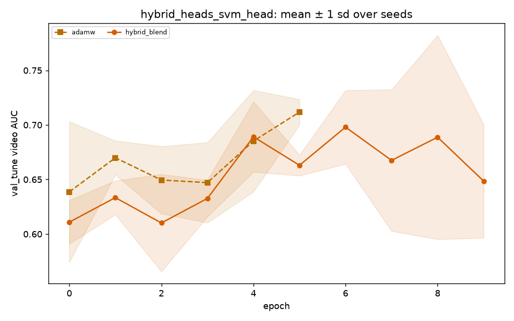

# hybrid_heads_svm_head: statistics

_Generated by `optlab stats` from the results database on 2026-10-16 02:54 UTC. Code version `5155285d034174bd4b3f585ecf86b1dabfa79480-dirty`._

**Hypothesis (recorded before the runs):** RMS-matched Adam/momentum with Lookahead improves validation stability; test superiority is unknown. Compare the full hybrid to each removed component and three established baselines at equal tuning budgets.

## Runs and tuning budget

| optimizer | completed | diverged | failed | tuning trials |
|---|---|---|---|---|
| adamw | 5 | 0 | 0 | 20 (random, 0 diverged) |
| hybrid_blend | 5 | 0 | 0 | 20 (random, 0 diverged) |

## Test AUC: optlab_timit_hq (in_distribution, frame level)

| optimizer | n seeds | AUC mean ± sd | 95% CI | EER mean | fit time (s) |
|---|---|---|---|---|---|
| adamw | 5 | 0.7229 ± 0.0598 | [0.6762, 0.7700] | 0.3278 | 0.3 |
| hybrid_blend | 5 | 0.6985 ± 0.0744 | [0.6402, 0.7569] | 0.3466 | 0.3 |

## Test AUC: optlab_timit_hq (in_distribution, video level)

| optimizer | n seeds | AUC mean ± sd | 95% CI | EER mean | fit time (s) |
|---|---|---|---|---|---|
| adamw | 5 | 0.7400 ± 0.0752 | [0.6829, 0.7966] | 0.3050 | 0.3 |
| hybrid_blend | 5 | 0.7110 ± 0.0860 | [0.6447, 0.7772] | 0.3450 | 0.3 |

### Pairwise, optlab_timit_hq video AUC

0 of 1 pairs distinguishable; the rest are within seed noise.

| a | b | mean diff | 95% CI | Cohen's d | Holm p | verdict |
|---|---|---|---|---|---|---|
| adamw | hybrid_blend | 0.0290 | [-0.0599, 0.1173] | 0.36 | 0.586 | within noise |

## Test AUC: optlab_timit_lq (cross_dataset, frame level)

| optimizer | n seeds | AUC mean ± sd | 95% CI | EER mean | fit time (s) |
|---|---|---|---|---|---|
| adamw | 5 | 0.8094 ± 0.0379 | [0.7811, 0.8375] | 0.2641 | 0.3 |
| hybrid_blend | 5 | 0.7458 ± 0.0861 | [0.6800, 0.8122] | 0.3059 | 0.3 |

## Test AUC: optlab_timit_lq (cross_dataset, video level)

| optimizer | n seeds | AUC mean ± sd | 95% CI | EER mean | fit time (s) |
|---|---|---|---|---|---|
| adamw | 5 | 0.8256 ± 0.0427 | [0.7915, 0.8590] | 0.2450 | 0.3 |
| hybrid_blend | 5 | 0.7502 ± 0.0972 | [0.6760, 0.8245] | 0.3050 | 0.3 |

### Pairwise, optlab_timit_lq video AUC

0 of 1 pairs distinguishable; the rest are within seed noise.

| a | b | mean diff | 95% CI | Cohen's d | Holm p | verdict |
|---|---|---|---|---|---|---|
| adamw | hybrid_blend | 0.0754 | [-0.0079, 0.1558] | 1.00 | 0.168 | within noise |

## Generalization gap (in-distribution − cross-dataset test AUC, video)

Each comparison uses only seeds evaluated on both datasets.

| optimizer | in-distribution dataset | comparison dataset | paired seeds | gap mean ± sd | 95% CI |
|---|---|---|---|---|---|
| adamw | optlab_timit_hq | optlab_timit_lq | 5 | -0.0856 ± 0.0703 | [-0.1477, -0.0397] |
| hybrid_blend | optlab_timit_hq | optlab_timit_lq | 5 | -0.0392 ± 0.0309 | [-0.0622, -0.0163] |

## Convergence (val_tune; target = 0.95 × best mean peak AUC)

| optimizer | epochs to val AUC ≥ 0.7234 | seeds reaching it | area under val loss | ≈ wall clock to target (s) | divergence rate |
|---|---|---|---|---|---|
| adamw | 6.0 | 5/5 | 12.636 | 0.1 | 0/5 |
| hybrid_blend | 6.0 | 3/5 | 14.328 | 0.1 | 0/5 |

