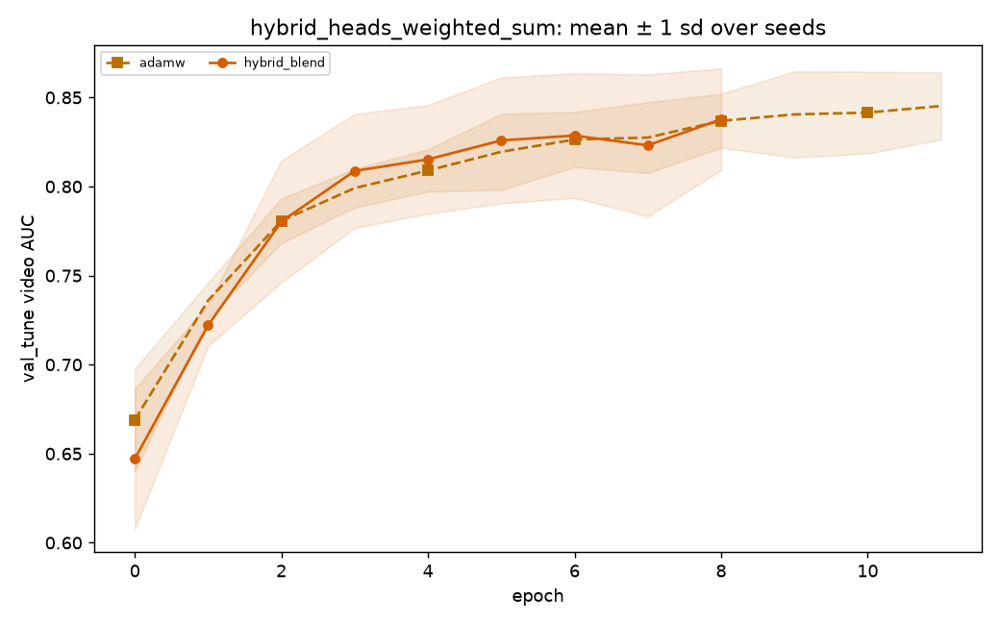

# hybrid_heads_weighted_sum: statistics

_Generated by `optlab stats` from the results database on 2026-10-16 02:53 UTC. Code version `5155285d034174bd4b3f585ecf86b1dabfa79480-dirty`._

**Hypothesis (recorded before the runs):** RMS-matched Adam/momentum with Lookahead improves validation stability; test superiority is unknown. Compare the full hybrid to each removed component and three established baselines at equal tuning budgets.

## Runs and tuning budget

| optimizer | completed | diverged | failed | tuning trials |
|---|---|---|---|---|
| adamw | 5 | 0 | 0 | 20 (random, 0 diverged) |
| hybrid_blend | 5 | 0 | 0 | 20 (random, 0 diverged) |

## Test AUC: optlab_timit_hq (in_distribution, frame level)

| optimizer | n seeds | AUC mean ± sd | 95% CI | EER mean | fit time (s) |
|---|---|---|---|---|---|
| adamw | 5 | 0.7615 ± 0.0146 | [0.7518, 0.7735] | 0.2934 | 4.8 |
| hybrid_blend | 5 | 0.7506 ± 0.0142 | [0.7376, 0.7594] | 0.3094 | 2.9 |

## Test AUC: optlab_timit_hq (in_distribution, video level)

| optimizer | n seeds | AUC mean ± sd | 95% CI | EER mean | fit time (s) |
|---|---|---|---|---|---|
| adamw | 5 | 0.7631 ± 0.0195 | [0.7478, 0.7790] | 0.2650 | 4.8 |
| hybrid_blend | 5 | 0.7516 ± 0.0178 | [0.7358, 0.7629] | 0.2900 | 2.9 |

### Pairwise, optlab_timit_hq video AUC

0 of 1 pairs distinguishable; the rest are within seed noise.

| a | b | mean diff | 95% CI | Cohen's d | Holm p | verdict |
|---|---|---|---|---|---|---|
| adamw | hybrid_blend | 0.0115 | [-0.0081, 0.0334] | 0.62 | 0.358 | within noise |

## Test AUC: optlab_timit_lq (cross_dataset, frame level)

| optimizer | n seeds | AUC mean ± sd | 95% CI | EER mean | fit time (s) |
|---|---|---|---|---|---|
| adamw | 5 | 0.8596 ± 0.0117 | [0.8507, 0.8696] | 0.2437 | 4.8 |
| hybrid_blend | 5 | 0.8491 ± 0.0132 | [0.8391, 0.8600] | 0.2509 | 2.9 |

## Test AUC: optlab_timit_lq (cross_dataset, video level)

| optimizer | n seeds | AUC mean ± sd | 95% CI | EER mean | fit time (s) |
|---|---|---|---|---|---|
| adamw | 5 | 0.8694 ± 0.0186 | [0.8546, 0.8838] | 0.2500 | 4.8 |
| hybrid_blend | 5 | 0.8610 ± 0.0167 | [0.8488, 0.8742] | 0.2500 | 2.9 |

### Pairwise, optlab_timit_lq video AUC

0 of 1 pairs distinguishable; the rest are within seed noise.

| a | b | mean diff | 95% CI | Cohen's d | Holm p | verdict |
|---|---|---|---|---|---|---|
| adamw | hybrid_blend | 0.0084 | [-0.0122, 0.0274] | 0.47 | 0.476 | within noise |

## Generalization gap (in-distribution − cross-dataset test AUC, video)

Each comparison uses only seeds evaluated on both datasets.

| optimizer | in-distribution dataset | comparison dataset | paired seeds | gap mean ± sd | 95% CI |
|---|---|---|---|---|---|
| hybrid_blend | optlab_timit_hq | optlab_timit_lq | 5 | -0.1094 ± 0.0193 | [-0.1244, -0.0945] |
| adamw | optlab_timit_hq | optlab_timit_lq | 5 | -0.1062 ± 0.0211 | [-0.1255, -0.0911] |

## Convergence (val_tune; target = 0.95 × best mean peak AUC)

| optimizer | epochs to val AUC ≥ 0.8228 | seeds reaching it | area under val loss | ≈ wall clock to target (s) | divergence rate |
|---|---|---|---|---|---|
| adamw | 6.0 | 5/5 | 31.393 | 1.6 | 0/5 |
| hybrid_blend | 5.0 | 5/5 | 26.269 | 1.3 | 0/5 |

