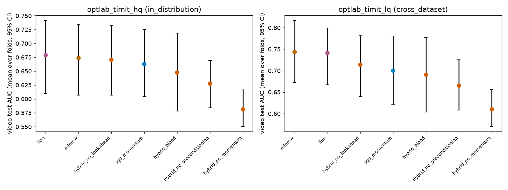

# hybrid_timit_cv: cross-validated statistics

_Generated by `optlab cv-stats` from the results database on 2026-10-16 02:53 UTC._

Runs by status: completed 280.

One fold = one held-out group of people; per fold, AUC is averaged over seeds, and optimizers are compared paired by fold.

## optlab_timit_hq (in_distribution): video test AUC across folds

| optimizer | folds | AUC mean ± sd over folds | 95% CI |
|---|---|---|---|
| lion | 8 | 0.6789 ± 0.1019 | [0.6099, 0.7412] |
| adamw | 8 | 0.6738 ± 0.0990 | [0.6067, 0.7340] |
| hybrid_no_lookahead | 8 | 0.6708 ± 0.0980 | [0.6070, 0.7322] |
| sgd_momentum | 8 | 0.6626 ± 0.0913 | [0.6046, 0.7250] |
| hybrid_blend | 8 | 0.6475 ± 0.1091 | [0.5780, 0.7188] |
| hybrid_no_preconditioning | 8 | 0.6275 ± 0.0666 | [0.5841, 0.6696] |
| hybrid_no_momentum | 8 | 0.5812 ± 0.0534 | [0.5507, 0.6177] |

**Paired comparisons:** 0 of 21 pairs distinguishable. Strongest ten by Holm p:

| a | b | folds | mean diff | 95% CI | paired d | Holm p | verdict |
|---|---|---|---|---|---|---|---|
| adamw | hybrid_no_momentum | 8 | 0.0926 | [0.0471, 0.1357] | 1.34 | 0.141 | within noise |
| hybrid_no_momentum | hybrid_no_lookahead | 8 | -0.0896 | [-0.1358, -0.0484] | -1.31 | 0.149 | within noise |
| lion | hybrid_no_momentum | 8 | 0.0977 | [0.0406, 0.1518] | 1.14 | 0.282 | within noise |
| sgd_momentum | hybrid_no_momentum | 8 | 0.0815 | [0.0242, 0.1383] | 0.93 | 0.618 | within noise |
| adamw | lion | 8 | -0.0051 | [-0.0362, 0.0351] | -0.09 | 1.000 | within noise |
| adamw | sgd_momentum | 8 | 0.0112 | [-0.0434, 0.0666] | 0.13 | 1.000 | within noise |
| adamw | hybrid_blend | 8 | 0.0263 | [-0.0188, 0.0713] | 0.38 | 1.000 | within noise |
| adamw | hybrid_no_preconditioning | 8 | 0.0463 | [-0.0121, 0.1033] | 0.52 | 1.000 | within noise |
| adamw | hybrid_no_lookahead | 8 | 0.0030 | [-0.0279, 0.0369] | 0.06 | 1.000 | within noise |
| lion | sgd_momentum | 8 | 0.0162 | [-0.0451, 0.0782] | 0.17 | 1.000 | within noise |

## optlab_timit_lq (cross_dataset): video test AUC across folds

| optimizer | folds | AUC mean ± sd over folds | 95% CI |
|---|---|---|---|
| adamw | 8 | 0.7431 ± 0.1102 | [0.6725, 0.8164] |
| lion | 8 | 0.7408 ± 0.1022 | [0.6671, 0.7992] |
| hybrid_no_lookahead | 8 | 0.7139 ± 0.1101 | [0.6396, 0.7813] |
| sgd_momentum | 8 | 0.7001 ± 0.1215 | [0.6221, 0.7803] |
| hybrid_blend | 8 | 0.6903 ± 0.1328 | [0.6037, 0.7766] |
| hybrid_no_preconditioning | 8 | 0.6651 ± 0.0909 | [0.6083, 0.7255] |
| hybrid_no_momentum | 8 | 0.6099 ± 0.0679 | [0.5705, 0.6561] |

**Paired comparisons:** 1 of 21 pairs distinguishable. Strongest ten by Holm p:

| a | b | folds | mean diff | 95% CI | paired d | Holm p | verdict |
|---|---|---|---|---|---|---|---|
| adamw | hybrid_no_momentum | 8 | 0.1332 | [0.0913, 0.1733] | 2.07 | 0.013 | distinguishable |
| lion | hybrid_no_momentum | 8 | 0.1308 | [0.0744, 0.1823] | 1.59 | 0.057 | within noise |
| hybrid_no_momentum | hybrid_no_lookahead | 8 | -0.1040 | [-0.1537, -0.0540] | -1.34 | 0.131 | within noise |
| adamw | hybrid_no_preconditioning | 8 | 0.0780 | [0.0339, 0.1310] | 1.03 | 0.398 | within noise |
| lion | hybrid_no_preconditioning | 8 | 0.0756 | [0.0183, 0.1360] | 0.84 | 0.846 | within noise |
| adamw | hybrid_no_lookahead | 8 | 0.0292 | [0.0074, 0.0541] | 0.80 | 0.876 | within noise |
| sgd_momentum | hybrid_no_momentum | 8 | 0.0902 | [0.0202, 0.1634] | 0.81 | 0.876 | within noise |
| hybrid_no_preconditioning | hybrid_no_momentum | 8 | 0.0552 | [0.0078, 0.0934] | 0.81 | 0.876 | within noise |
| adamw | lion | 8 | 0.0023 | [-0.0302, 0.0404] | 0.04 | 1.000 | within noise |
| adamw | sgd_momentum | 8 | 0.0430 | [-0.0185, 0.1079] | 0.44 | 1.000 | within noise |

## Fusion: mixing weight vs contribution (all runs, all folds)

Contribution = the share of the fused logit's spread on val_fusion that a stream supplies (w_m · sd(z_m) / Σ).

| stream | mean weight | mean contribution | runs |
|---|---|---|---|
| visual | 0.865 | 0.956 | 280 |
| frequency | 0.096 | 0.041 | 280 |
| audio | 0.039 | 0.004 | 280 |
