# Toy benchmark summary

_Generated by `optlab toy-report` from the results database on 2026-10-16 02:52 UTC. Do not edit by hand;
run `optlab toy-report --config configs/experiments/hybrid_toy.yaml` with the desired output paths._

- Experiment: `hybrid_toy` (recorded 2026-10-15 16:29:41 UTC)
- Code version: `9d4ed71e411ae78b5510db96f10dc26b334bc0c4-dirty`
- Toy runs in the database: 215

## Protocol

Phase 3 toy validation of the frozen hybrid and three ablations; known-minimum checks.

One step is one `optimizer.step()`. For L-BFGS that is one outer iteration (its line-search
function evaluations are not counted); for Newton it is one `x ← x − H⁻¹g`. A run stops at the
first step with |f − f*| ≤ tolerance, on divergence (non-finite or |f| above the threshold), or
at max steps. Diverged runs are kept and shown as diverged, not dropped.

| benchmark | dim | κ | max steps | tolerance |f − f*| | seeds |
|---|---|---|---|---|---|
| hybrid_quadratic_k10 | 2 | 10 | 5000 | 1e-08 | 5 |
| hybrid_quadratic_k100 | 2 | 100 | 5000 | 1e-08 | 5 |
| hybrid_quadratic_k1000 | 2 | 1000 | 5000 | 1e-08 | 5 |
| hybrid_rosenbrock | 2 |  | 5000 | 1e-06 | 5 |
| hybrid_rastrigin | 2 |  | 5000 | 1e-06 | 5 |

## Hypothesis (recorded before the runs)

Blend and Lookahead alter stability; tight-tolerance convergence is measured rather than assumed.

## Steps to tolerance

Median [min–max] over the seeds that reached tolerance, and (seeds reached / seeds run).
"—" means no seed reached tolerance within max steps.

| optimizer | hybrid_quadratic_k10 | hybrid_quadratic_k100 | hybrid_quadratic_k1000 | hybrid_rosenbrock | hybrid_rastrigin |
|---|---|---|---|---|---|
| adamw | 146 [101–169] (5/5) | 318 [133–500] (5/5) | 1544 [523–2091] (5/5) | 793 [499–1147] (4/5) | — (0/5) |
| lion | 4969 (1/5) | — (0/5) | — (0/5) | 2670.5 [2207–3134] (2/5) | — (0/5) |
| sgd_momentum | 130 [122–161] (5/5) | 171 [138–171] (5/5) | 171 [138–204] (5/5) | 1624 [1441–2266] (3/5) | — (0/5) |
| hybrid_blend | 98 [67–123] (5/5) | 484 [99–773] (5/5) | 2032 [784–2853] (5/5) | 3161.5 [2504–4102] (4/5) | — (0/5) |
| hybrid_no_preconditioning | 75 [58–113] (5/5) | 479 [98–689] (5/5) | 2009 [778–2613] (5/5) | 3117 [2482–4798] (5/5) | — (0/5) |
| hybrid_no_momentum | 110 [100–125] (5/5) | 758 [193–863] (5/5) | 1500 (1/5) | — (0/5) | — (0/5) |
| hybrid_no_lookahead | 614 [109–902] (5/5) | 909 [133–1336] (5/5) | 1539 [521–2001] (5/5) | 698 [503–1114] (5/5) | 3055 (1/5) |
| newton | 1 [1–1] (5/5) | 1 [1–1] (5/5) | 1 [1–1] (5/5) | 4 [3–5] (5/5) |  |
| lbfgs | 4 [3–7] (5/5) | 4 [3–8] (5/5) | 4 [3–8] (5/5) | 21 [19–26] (5/5) |  |

## Final f

Median final f over non-diverged seeds (f* = 0 for every benchmark).

| optimizer | hybrid_quadratic_k10 | hybrid_quadratic_k100 | hybrid_quadratic_k1000 | hybrid_rosenbrock | hybrid_rastrigin |
|---|---|---|---|---|---|
| adamw | 5.31e-09 | 9.6e-09 | 9.92e-09 | 9.97e-07 | 24.9 |
| lion | 0.115 | 0.12 | 0.135 | 0.00013 | 24.9 |
| sgd_momentum | 3.24e-09 | 1.86e-09 | 3.92e-09 | 9.93e-07 (2 diverged) | 24.9 |
| hybrid_blend | 4.25e-09 | 9.55e-09 | 9.88e-09 | 9.93e-07 | 20 |
| hybrid_no_preconditioning | 3.81e-09 | 9.53e-09 | 9.94e-09 | 9.96e-07 | 9.95 |
| hybrid_no_momentum | 2.01e-09 | 9.73e-09 | 1.18e-06 | 0.0327 | 24.9 |
| hybrid_no_lookahead | 9.73e-09 | 9.86e-09 | 9.95e-09 | 9.83e-07 | 4.98 |
| newton | 2.32e-32 | 3.11e-30 | 3.83e-28 | 5.62e-08 |  |
| lbfgs | 3.3e-10 | 2.18e-12 | 2.61e-15 | 8.32e-08 |  |

## Selected learning rate

| optimizer | hybrid_quadratic_k10 | hybrid_quadratic_k100 | hybrid_quadratic_k1000 | hybrid_rosenbrock | hybrid_rastrigin |
|---|---|---|---|---|---|
| adamw | 0.1 | 0.1 | 0.1 | 1 | 0.0003 |
| lion | 0.0001 | 0.0001 | 0.0001 | 0.001 | 0.0001 |
| sgd_momentum | 0.01 | 0.03 | 0.003 | 0.001 | 0.0001 |
| hybrid_blend | 0.1 | 0.1 | 0.1 | 0.1 | 1 |
| hybrid_no_preconditioning | 0.3 | 0.1 | 0.1 | 0.1 | 1 |
| hybrid_no_momentum | 0.3 | 0.1 | 0.3 | 0.01 | 0.001 |
| hybrid_no_lookahead | 0.01 | 0.03 | 0.1 | 1 | 1 |
| newton | fixed | fixed | fixed | fixed |  |
| lbfgs | 1 | 1 | 1 | 1 |  |

## Plots

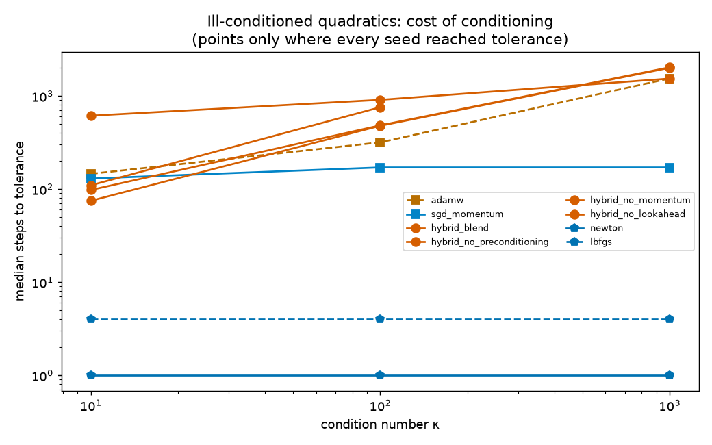
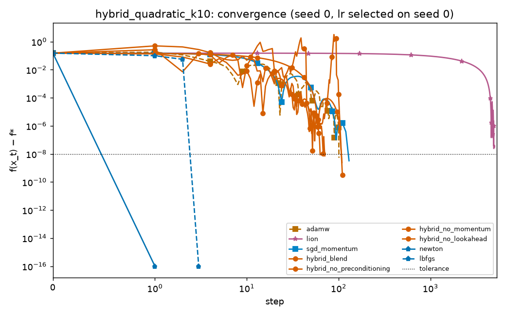
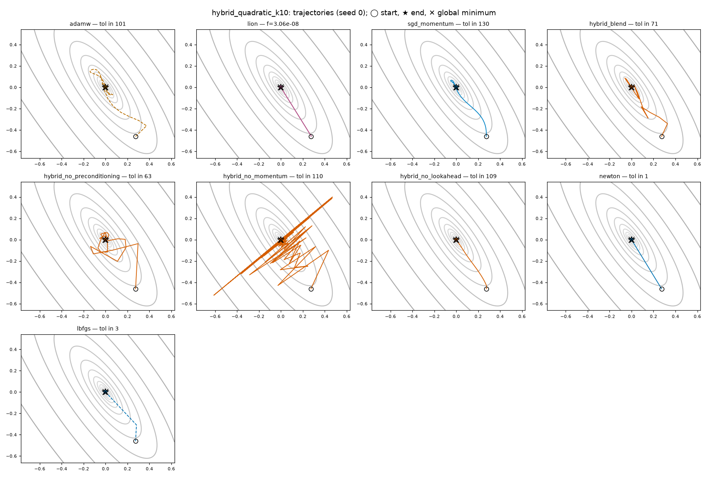
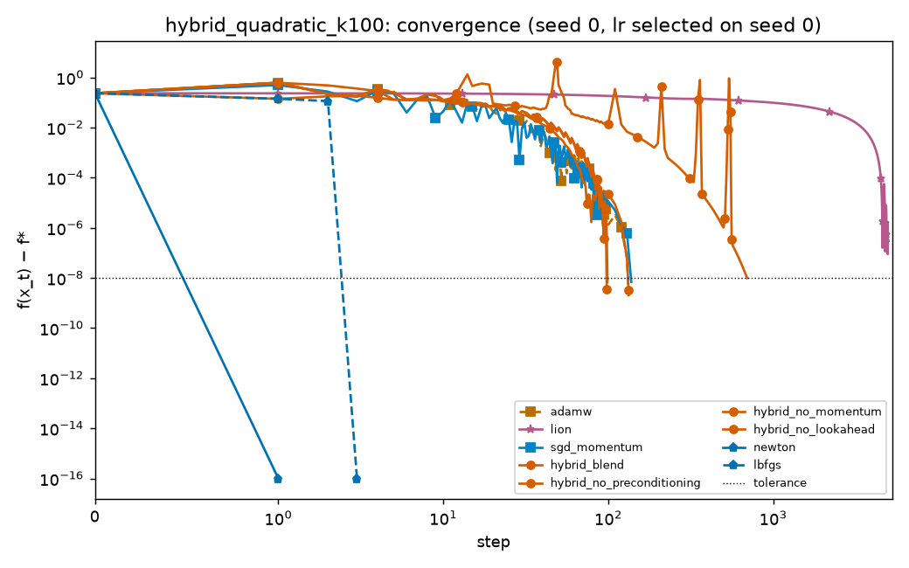
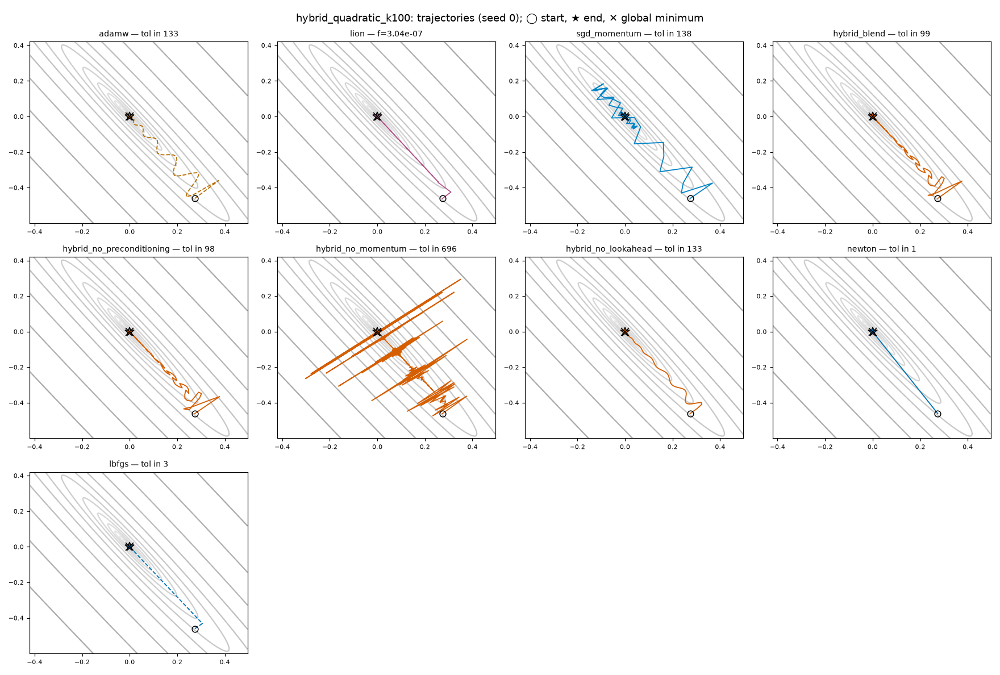
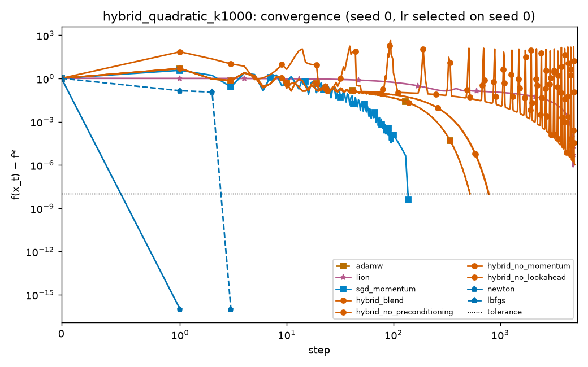
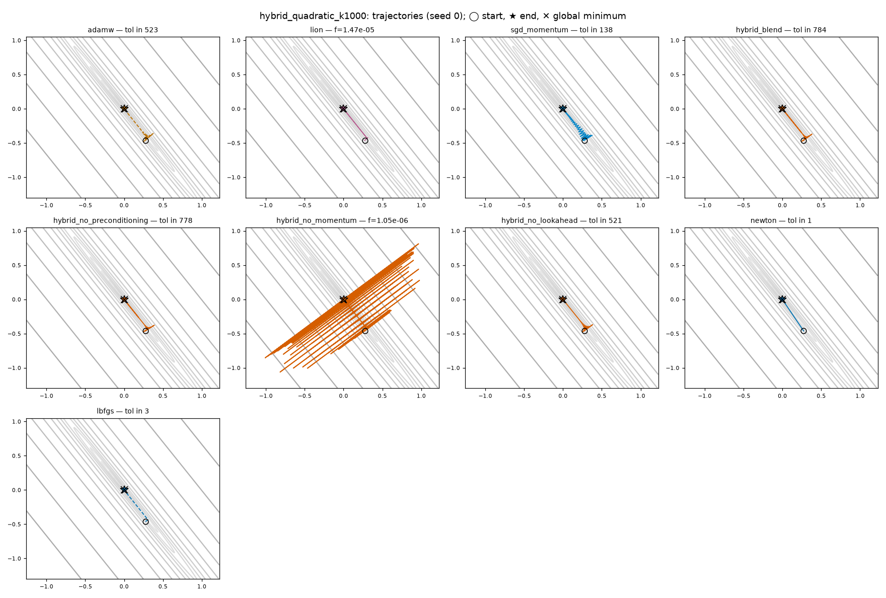
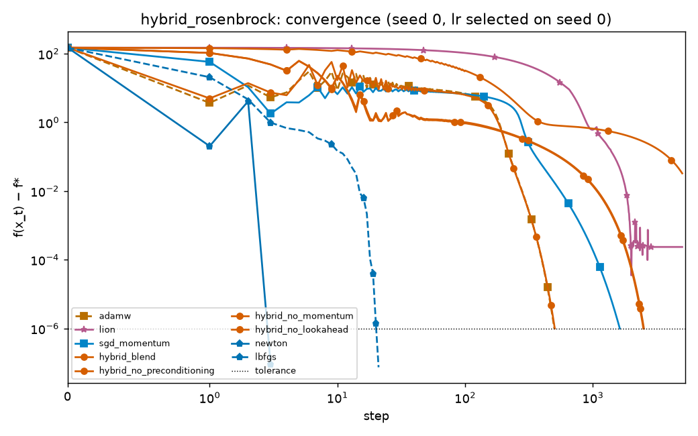
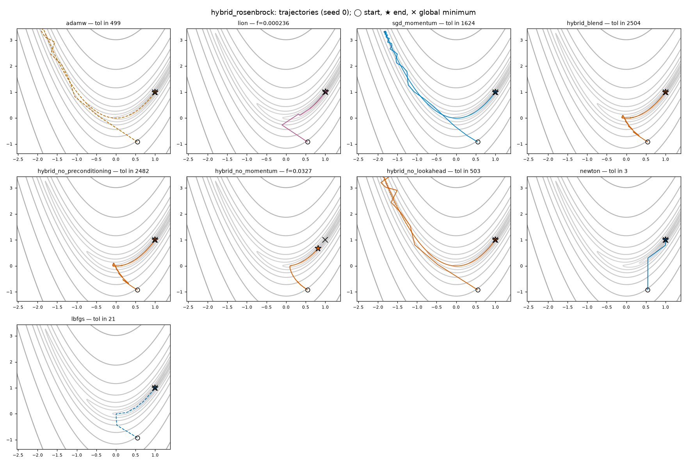
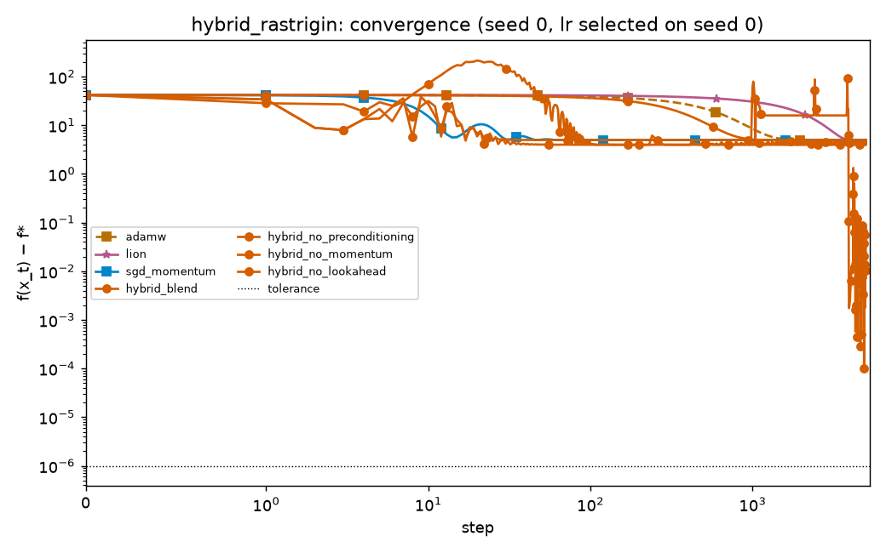
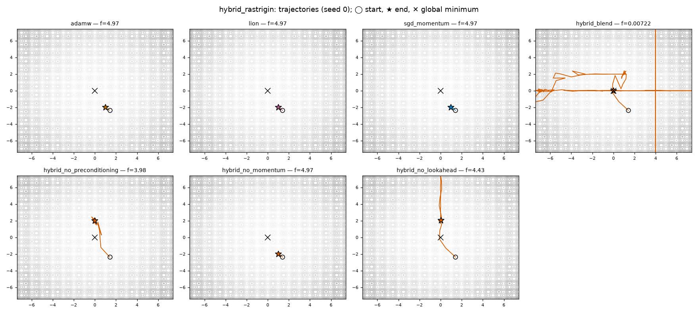
