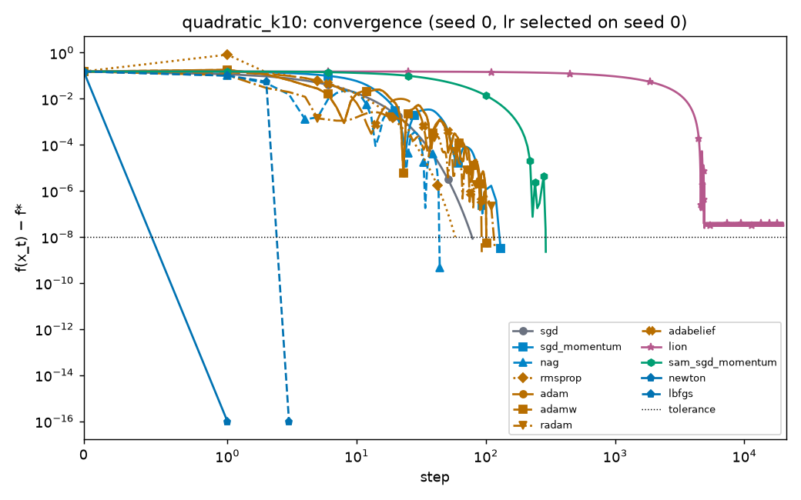
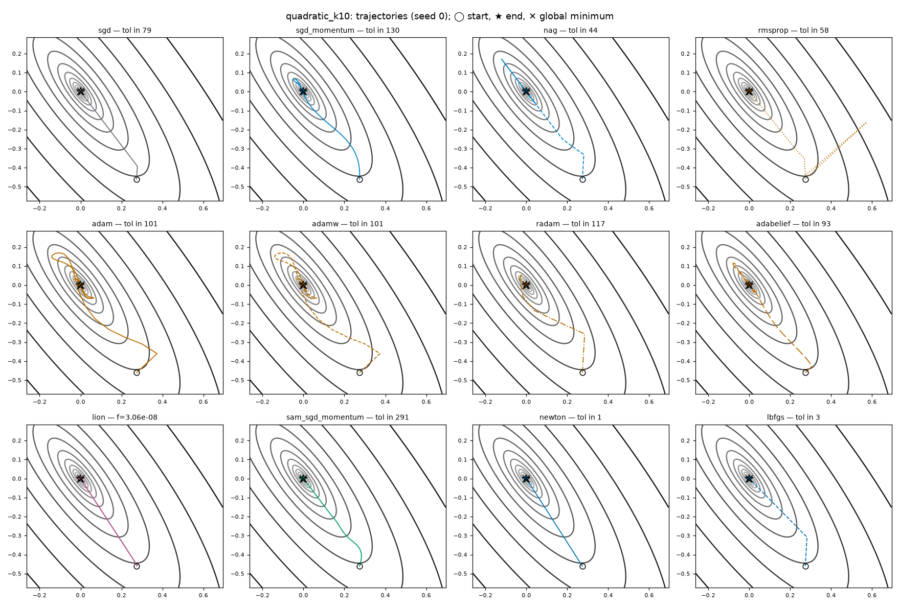
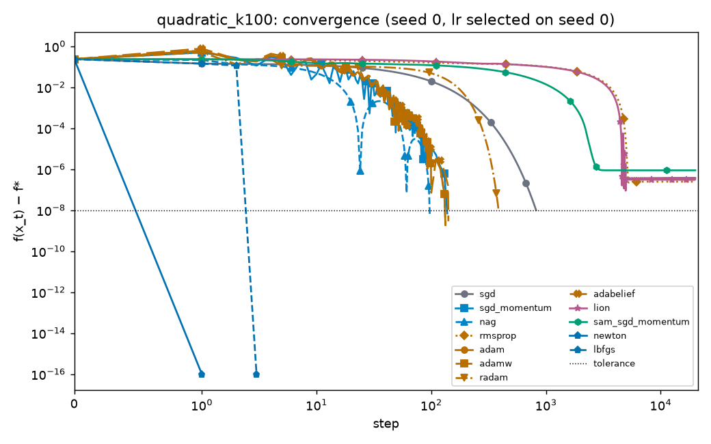
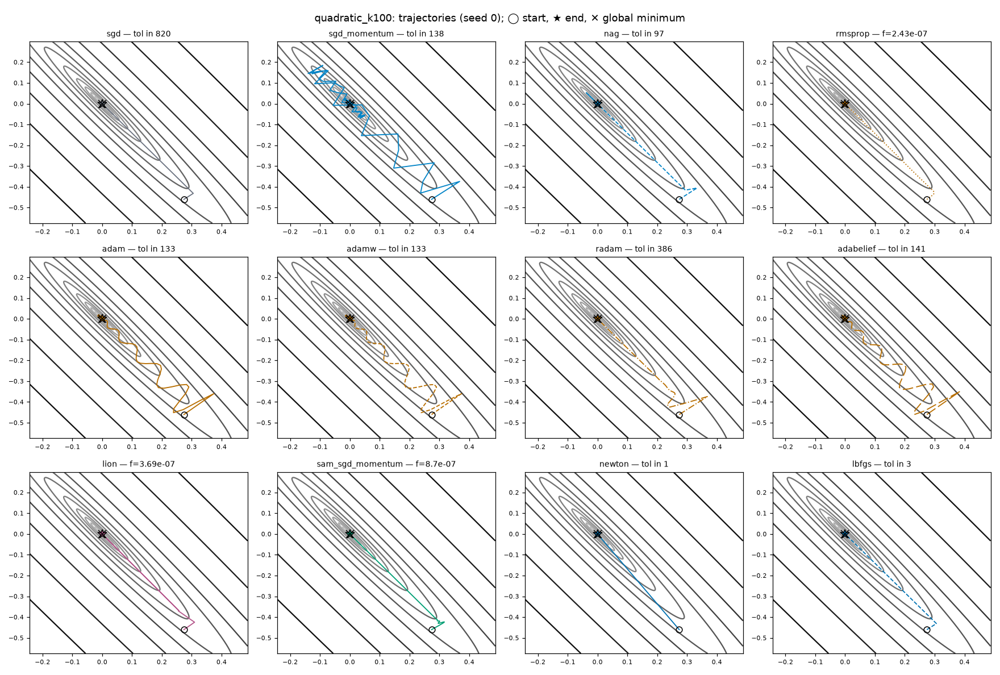
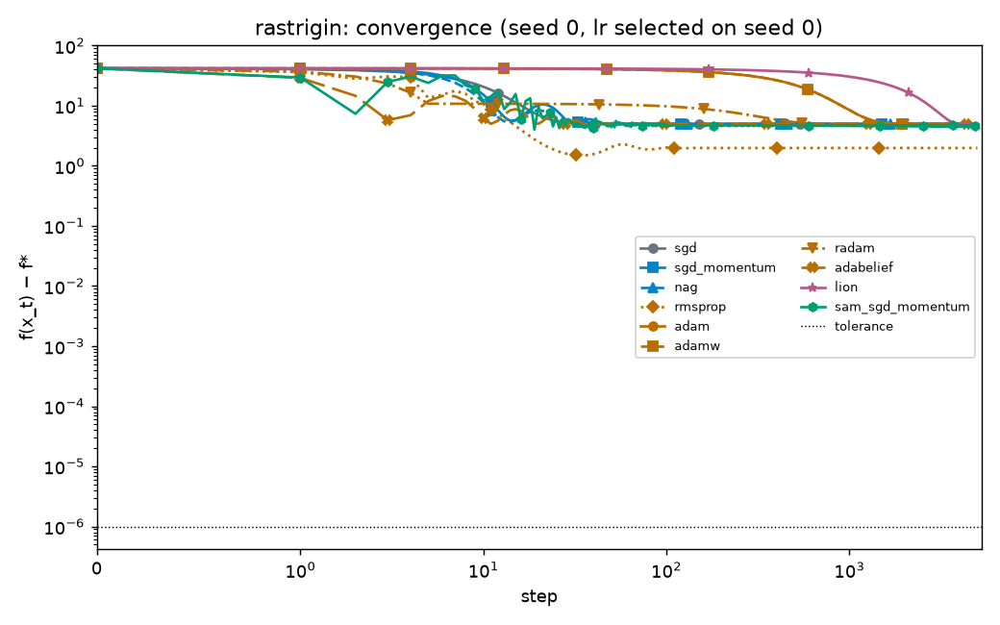

# Toy benchmark summary

_Generated by `optlab toy-report` from the results database on 2026-10-12 17:35 UTC. Do not edit by hand;
run `make toy` to regenerate._

- Experiment: `toy_v1` (recorded 2026-10-12 17:29:29 UTC)
- Code version: `a7a964ebc0181029fdcf618de5eb6f70a34dbbc0`
- Toy runs in the database: 290

## Protocol

Phase 1. Every optimizer on functions with known minima, deterministic full gradients, no weight decay. The learning rate for each (benchmark, optimizer) is the value in lr_grid that reaches tolerance in the fewest steps on tuning_seed (ties and misses broken by the lowest final f); that value is then used for every seed.

One step is one `optimizer.step()`. For L-BFGS that is one outer iteration (its line-search
function evaluations are not counted); for Newton it is one `x ← x − H⁻¹g`. A run stops at the
first step with |f − f*| ≤ tolerance, on divergence (non-finite or |f| above the threshold), or
at max steps. Diverged runs are kept and shown as diverged, not dropped.

| benchmark | dim | κ | max steps | tolerance |f − f*| | seeds |
|---|---|---|---|---|---|
| quadratic_k10 | 2 | 10 | 20000 | 1e-08 | 5 |
| quadratic_k100 | 2 | 100 | 20000 | 1e-08 | 5 |
| quadratic_k1000 | 2 | 1000 | 20000 | 1e-08 | 5 |
| rosenbrock | 2 |  | 20000 | 1e-06 | 5 |
| rastrigin | 2 |  | 5000 | 1e-06 | 5 |

## Hypothesis (recorded before the runs)

(1) On the quadratics, steps-to-tolerance of tuned plain GD grows roughly linearly with the condition number and momentum/NAG roughly with its square root, so the gap widens as kappa grows. (2) Newton reaches tolerance in one step on every quadratic; L-BFGS in a handful. (3) Lion's fixed-size sign steps stall above tight tolerances unless the learning rate is very small. (4) On Rastrigin no first-order optimizer reliably reaches the global minimum from random starts; final values depend mostly on the start point.

## Steps to tolerance

Median [min–max] over the seeds that reached tolerance, and (seeds reached / seeds run).
"—" means no seed reached tolerance within max steps.

| optimizer | quadratic_k10 | quadratic_k100 | quadratic_k1000 | rosenbrock | rastrigin |
|---|---|---|---|---|---|
| sgd | 78 [56–82] (5/5) | 812 [582–850] (5/5) | 8153 [5841–8534] (5/5) | 14269 [13632–14676] (5/5) | — (0/5) |
| sgd_momentum | 130 [122–161] (5/5) | 171 [138–171] (5/5) | 171 [138–204] (5/5) | 1624 [1441–2266] (3/5) | — (0/5) |
| nag | 44 [34–44] (5/5) | 97 [24–98] (5/5) | 748 [538–782] (5/5) | 1452 [1432–1472] (2/5) | — (0/5) |
| rmsprop | 89 [58–136] (5/5) | 5984 (1/5) | — (0/5) | — (0/5) | — (0/5) |
| adam | 146 [101–169] (5/5) | 318 [133–500] (5/5) | 1544 [523–2091] (5/5) | 793 [499–1147] (4/5) | — (0/5) |
| adamw | 146 [101–169] (5/5) | 318 [133–500] (5/5) | 1544 [523–2091] (5/5) | 793 [499–1147] (4/5) | — (0/5) |
| radam | 133 [105–160] (5/5) | 1501 [386–1813] (5/5) | 8578 [3593–9493] (5/5) | 10558 [6430–10670] (3/5) | — (0/5) |
| adabelief | 187 [93–189] (5/5) | 291 [141–449] (5/5) | 1461 [556–1933] (5/5) | 805.5 [566–1143] (4/5) | — (0/5) |
| lion | 9009 [4969–9295] (3/5) | 7074 [5138–9010] (2/5) | — (0/5) | 3742 (1/5) | — (0/5) |
| sam_sgd_momentum | 291 (1/5) | — (0/5) | — (0/5) | — (0/5) | — (0/5) |
| newton | 1 [1–1] (5/5) | 1 [1–1] (5/5) | 1 [1–1] (5/5) | 4 [3–5] (5/5) |  |
| lbfgs | 4 [3–7] (5/5) | 4 [3–8] (5/5) | 4 [3–8] (5/5) | 21 [19–26] (5/5) |  |

## Final f

Median final f over non-diverged seeds (f* = 0 for every benchmark).

| optimizer | quadratic_k10 | quadratic_k100 | quadratic_k1000 | rosenbrock | rastrigin |
|---|---|---|---|---|---|
| sgd | 8.77e-09 | 9.9e-09 | 9.99e-09 | 1e-06 | 24.9 |
| sgd_momentum | 3.24e-09 | 1.86e-09 | 3.92e-09 | 9.93e-07 (2 diverged) | 24.9 |
| nag | 8.25e-10 | 6.51e-09 | 9.9e-09 | 9.97e-07 (3 diverged) | 24.9 |
| rmsprop | 9.49e-09 | 2.43e-07 | 2.43e-06 | 2.03e-05 | 20.9 |
| adam | 5.31e-09 | 9.6e-09 | 9.92e-09 | 9.97e-07 | 24.9 |
| adamw | 5.31e-09 | 9.6e-09 | 9.92e-09 | 9.97e-07 | 24.9 |
| radam | 4.36e-09 | 9.97e-09 | 9.97e-09 | 9.98e-07 (2 diverged) | 24.9 |
| adabelief | 8.99e-09 | 9.67e-09 | 9.9e-09 | 9.83e-07 | 24.9 |
| lion | 7.18e-09 | 8.4e-08 | 4.72e-06 | 2.44e-05 | 24.9 |
| sam_sgd_momentum | 3.86e-07 | 8.7e-07 | 0.00855 | 0.094 | 25.7 |
| newton | 2.32e-32 | 3.11e-30 | 3.83e-28 | 5.62e-08 |  |
| lbfgs | 3.3e-10 | 2.18e-12 | 2.61e-15 | 8.32e-08 |  |

## Selected learning rate

| optimizer | quadratic_k10 | quadratic_k100 | quadratic_k1000 | rosenbrock | rastrigin |
|---|---|---|---|---|---|
| sgd | 0.1 | 0.01 | 0.001 | 0.001 | 0.0003 |
| sgd_momentum | 0.01 | 0.03 | 0.003 | 0.001 | 0.0001 |
| nag | 0.1 | 0.01 | 0.001 | 0.001 | 0.0001 |
| rmsprop | 0.03 | 0.0001 | 0.0001 | 0.0003 | 0.1 |
| adam | 0.1 | 0.1 | 0.1 | 1 | 0.0003 |
| adamw | 0.1 | 0.1 | 0.1 | 1 | 0.0003 |
| radam | 0.3 | 0.03 | 0.003 | 0.003 | 0.001 |
| adabelief | 0.03 | 0.1 | 0.1 | 1 | 0.1 |
| lion | 0.0001 | 0.0001 | 0.0001 | 0.0003 | 0.0001 |
| sam_sgd_momentum | 0.001 | 0.0001 | 0.0001 | 0.0001 | 0.003 |
| newton | fixed | fixed | fixed | fixed |  |
| lbfgs | 1 | 1 | 1 | 1 |  |

## Plots

